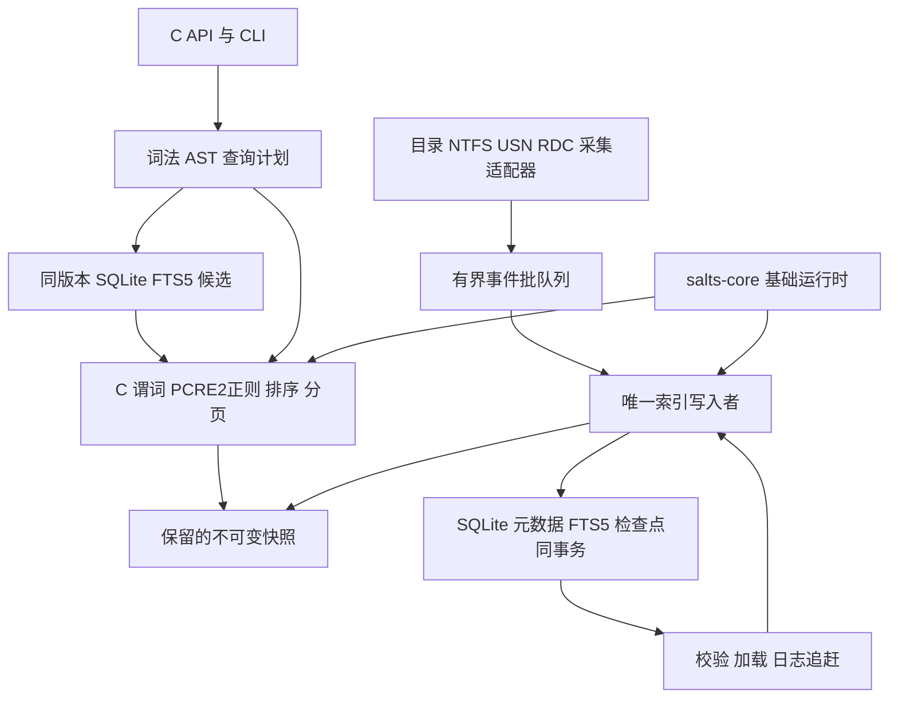

# C11 与 CMeta 文件搜索引擎设计

> **2026-11-04 跨平台与内容方案**：Linux inotify、macOS FSEvents，以及复用
> vcpkg-cache bfs/ugrep 的显式实时内容任务见[详细方案](cross-platform-content-search.md)。
> 这是待实现设计；包括工具静态依赖/LLVM-MinGW 缺口、文件身份、读取语义、取消预算和分阶段验收。

> **异步建索引实现**：新增独立单写入者任务 API、有界 NTFS 原生批队列和限定页数的 SQLite 内存工作集；文件事实、FTS、USN 游标提交成功后才发布不可变查询快照。完整内存镜像与未落盘增量可见仍属后续工作；生命周期及存储边界见[运行时契约](runtime-contract.md#asynchronous-indexing-and-bounded-ntfs-batches)。

> **2026-11-03 目录图批量写入**：RAW 工厂配置启用独立的 `FS_NTFS_RAW_BATCH_DIRS`，目录先有界暂存于 SQLite TEMP，再按完整 FRN 和发出顺序合并；重复 FRN 保留末条语义，数据库结构不变。暂存/合并、live 回核、U0/U1、事实/FTS/游标仍同事务，失败不发布；写连接每 2,048 条 VM 指令检查 STOPPING，可中断批量 SQL。与同构建直接落库对照，各 3 次初建中位数 26.25 / 27.05 s（墙钟低约 3%，范围重叠），CPU 19.53 / 23.89 s（低约 18%），进程写 I/O 低约 18%；不是物理磁盘写量或固定加速保证。两组真实卷各通过 3 用例 / 52,866 断言。当前正式回归 92 引擎 + 25 raw + 10 CLI；已更正上轮把实际 19 个 raw 用例误写为 25 的记录，并补齐 6 项预取错误/排空测试。详见[报告及四份独立 CSV](performance/raw-directory-batch-2026-11-03.md)。

实现状态：已实现保留快照扫描、FTS5 名字候选、PCRE2 正则、SQLite/FTS 事务维护和 C API/CLI；候选读取验证 identity/revision，旧版本退回保留镜像扫描。快照采用每页最多 4096 条目的不可变共享页。小索引默认内存扫描，fts_min_entries 默认 65,536，CLI --fts 可显式启用安全 FTS 计划。Windows 协作式 RDC 监控提供扫描前布防、整根失效重扫、溢出/线程退出恢复、根身份检查和停止唤醒；目录遍历绑定父句柄，失败义务按根保留。

NTFS/V2 后端已实现卷级目录图、选定子树完整别名枚举、U0/U1 交接、分批续读与事实/FTS/检查点同事务。文件改名/硬链接核对已保存和当前完整 FRN 的父目录，辅助查询不可用/拒绝时退回所选范围核对；纯元数据更新避免目录枚举，精确同版本且名字空间未变时仅复制受影响的快照页。权限失败/日志缺口不推进游标，旧结果继续有效。当前回归与真实卷结果见上方最新记录。早期 ENUM 优化验收 2 用例、52,824 断言通过，完整枚举约 457 万 MFT 记录并与 1 万文件子树逐项对账。元数据同步中位数由 1,986 ms 降至 255 ms，P95 由 3,480 ms 降至 1,935 ms；自动名字查询 0.608 ms，同轮强制 FTS 5.416 ms。该早期版本全卷初建约 60 s；不同时间的共享卷样本不能作为隔离速度保证。详见[优化与原始数据报告](performance/ntfs-optimization-2026-11-03.md)。

普通令牌的卷访问仍可能拒绝。专用异步事件队列、原始非法 Unicode 名字查询和 Everything 导入尚未交付。Linux Debug/ASan/UBSan 已通过异步索引正式回归；Linux 原生监听与 macOS 平台验收仍待实现。最新验证见[异步索引报告](performance/async-index-2026-11-03.md)，边界见[当前运行时契约](runtime-contract.md)。不提供 install/consumer 路径。

Raw MFT reader 已实现，可通过 `--raw-mft` 或 `FsNtfsConfig.mft_reader=FS_NTFS_MFT_RAW` 显式启用，默认仍为 ENUM。批量 FILE 记录从卷 extent 直接读取，支持 USA、bitmap 空块跳过、mapping pairs 与属性列表扩展；元数据/扩展记录使用有界内核解析接口，所选目录按当前内核父名核对，文件别名继续通过目录句柄完整采集。U0/U1、SQLite/FTS/游标事务及保留页协议保持。新配置结构需要重新编译宿主，失败不会自动切换模式。RAW 已加入双缓冲预取，最多一个未完成读取，复用单写入者；失败/STOPPING 先取消并排空 I/O 再释放缓冲区。`raw_flags=0` 选择直接落库和串行读取；`--raw-mft-sync` 只关闭预取。新配置结构需重新编译宿主。同一最终 Release 构建的预取/串行对照各通过 3 用例、52,866 断言；3 次初建中位数 36.63 / 39.73 s，本轮低 7.8%，范围重叠且未隔离系统缓存/负载。详见[预取报告](performance/raw-prefetch-2026-11-03.md)。详见[raw reader 协议、边界与验收](raw-mft-reader.md)。


版本：0.3，2026-11-02。采用 salts-core、SQLite FTS5 与 PCRE2；增加 ugrep/bfs 工具边界，保留 CMeta 声明层。目标实现名暂用 `fsx`，公开类型前缀 `Fs`，函数前缀 `fsx_`。

采用 **单写入者、SQLite 事务持久化、FTS5 trigram 候选、PCRE2 正则和同版本内存快照**。CMeta 声明类型、只读反射与采集协议；salts-core 提供基础运行时；fsx 负责身份、增量协调、查询规划及各层一致性。

首版面向 Windows 本机文件名搜索，提供目录枚举、名字/路径/扩展名/大小/修改时间查询、确定性排序、分页和持久化，并分阶段启用 PCRE2 正则。核心不依赖 Win32 类型；NTFS USN、RDC 和后续 MFT 后端放在平台适配层。SQLite 是唯一持久事实源，不再另建 FSXDB 提交链；Everything 导入作为独立且需验收的适配器。

## 1 范围和行为契约

| 项目 | 首版约定 |
|---|---|
| 语言 | C11；不要求 GNU 扩展、C++、本机代码生成或动态装载 |
| 入口 | 嵌入式 C API + CLI；GUI 和 IPC 是 API 的消费者 |
| 采集 | 默认枚举用户可访问的目录；可选特权代理读取 NTFS USN |
| 一致性 | 每个查询使用固定、内部一致的快照；索引最终追上变化 |
| 覆盖范围 | 每个源明确标记完整、局部可读、待同步或失效；权限拒绝不能冒充完整索引 |
| 搜索范围 | 文件名及已索引元数据；FTS5 用于文件名 trigram，PCRE2 用于正则；内容、近似匹配与媒体另立能力 |
| 兼容性 | 不复制 Everything 的 388 个 opcode、内存布局或未验证的库写入语义 |
| 性能 | 建立冷/热启动、查询 P50/P95/P99、峰值内存基线；本文的预算不代表实测性能 |

文件系统仍在变化，采集到的元数据不构成整个卷的事务快照。`caught_up` 仅说明处理到了一个已确认的日志位置；快照携带源状态和采集范围，客户端不能把它解释成当前磁盘的绝对真相。

## 2 CMeta 依赖与使用边界

设计依据本地 Salts 源码 `9df83cfc` 的公开头文件及 Salts 2.3.0 SDK。`enum.h`、`struct.h`、`interface.h`、`data_reflect.h`、`abi.h` 与该 SDK 的相应文件一致，Reflection ABI 为 **4**。本机另有 Salts 1.8.28 / ABI 3，不能混用。

当前工程采用独立 CMeta SDK，消费者链接 `CMeta::CMeta`；历史整体 Salts SDK 的 `Salts::CMeta` 不作为新工程依赖入口。构建时要求 C11，依赖恢复和构建沿用 Salts 工程的 presets 与 vcpkg manifest 约定；不要用更改全局 `CMETA_TYPE_LIST` 的方式扩大整个 SDK 的 callable ABI。

| 需要 | CMeta 表面 | 运行时责任 |
|---|---|---|
| 错误/状态枚举 | `cmeta_enum`，显式数值 | fsx 定义状态转换与错误传播 |
| 新的公开值记录 | `cmeta_struct` + `cmeta_field` | fsx 校验范围、预算和使用条件 |
| 已有结构的只读检查 | `cmeta_reflect_data` | 对象所有者保证读期间稳定 |
| 编译期采集协议 | `CMETA_INTERFACE` / `CMETA_IMPLEMENTS` | host 选择实例、管理 session 和关闭 |
| 一个概念生成多个表 | 必要时 `Schema` / `Replay` | 不生成索引算法、线程或存储管理器 |
| 一个局部平面展开 | `CMETA_PP_FOR_EACH` | 遵守非空、1–16 项契约 |

不为每条文件记录保存 descriptor、ObjectRef 或虚函数表。元数据按类型静态存在；扫描内层直接访问列和已编译的匹配器。

`cmeta_struct` 提供结构反射，不自动授予 DataDesc 生命周期。`cmeta_reflect_data` 是 VIEW，也不授予初始化、写入、复制、释放或跨线程访问权。同一原生类型的 Struct 元数据只声明一次，不能再用另一声明重复定义它。

首版没有跨 DSO 协议、Component 实例发现或热更新。以后需要这些能力时，分别处理 provider 的 Reflection epoch、精确 Function ABI、实例寿命及模块 lease；descriptor 地址不能充当全局类型 ID。

### 2.1 选定依赖

| 依赖 | 职责 | 不承担的职责 |
|---|---|---|
| salts-core | Core buffer、Platform 线程/同步/时钟、Concurrency 线程池、FS、Unicode | 不提供本项目的目录项模型、USN 交接或查询规划 |
| CMeta | 第 5 节的声明、反射与静态协议 | 不管理 SQLite connection、PCRE2 pattern 或 buffer 的所有权 |
| SQLite + FTS5 | 元数据/恢复状态事务持久化；文件名 trigram 候选 | 不自动实现任意短串、正则、近似匹配或 Windows 权限语义 |
| PCRE2 8-bit + JIT | 普通正则的唯一后端；编译一次、反复匹配 | 不替代 FTS5 候选、普通子串或编辑距离 |
| ugrep | 独立内容搜索 CLI，后续显式内容能力与正式性能对照可复用 | C++ 工具不链接进 C11 核心，不提供 fsx 索引事务 |
| bfs | POSIX 遍历 CLI，Linux/macOS 遍历行为与性能参考 | 不替代 Windows 枚举/USN、稳定身份或增量一致性 |

普通正则按性能目标选择 PCRE2/JIT，不把“最快”作为跨模式、数据和平台的已证结论。发布前用正式基准记录 literal、字符类、Unicode、回溯压力以及冷编译/热复用的耗时和内存。ugrep 默认匹配器与 `-P` 的 PCRE2 语义不同，比较时必须固定选项。

salts-core 参考本地 `abcf33e`、CMake 包版本 0.1.2；实际发布/平台验收按选定 SDK 处理。`find_package(SaltsCore CONFIG REQUIRED)` 导出的是 `Salts::Core`、`Salts::Platform`、`Salts::Concurrency`、`Salts::FS` 等，不能根据仓库名猜成 `SaltsCore::Core`。

**依赖所有者必须唯一**：当前旧 Salts 2.3.0 整体 export 也声明 `Salts::Core/Platform/Concurrency`，不能与独立 SaltsCore 整包直接混装。CMeta 必须从已适配同一 Core 的 SDK 或独立、兼容的元数据 export 引入；不能跳过导入冲突检查或再编译一份旧 Core。当前 API 依据和最终可组合 SDK 的验收是两件事。

salts-core 当前包含的能力按其所有者复用：`thread.h` 的 `cmeta_mutex_*` / `cmeta_cond_*`、`thread_pool.h` 的有界线程池、`cmeta_buffer.h` 的 `mem_buffer_retain/release`。这些历史 `cmeta_` 前缀不意味着它们依赖 CMeta Reflection。mutex 初始化为 void 的接口要检查输出句柄非空；绝不能让初始化失败后变成无锁继续运行。

`cmeta_deadline_queue` 是单 owner 的定时排序结构，不是 MPSC 数据队列；事件队列仍由 fsx 用 Core 同步原语实现明确的有界 MPSC 协议。Core 的 `re.h` 是另一套匹配器；本项目不把它和 PCRE2 结果混用或悄悄切换。

buffer 池自身仍由 engine 管理，所有 buffer/slice/旧快照释放后才能 destroy/reset。引用计数不赋予无限扩容能力；fsx 在池分配前预留全局预算。线程池 task 成功接收后通过 run/cancel → finalize 结束，payload 的最后一次释放放在 finalize；提交失败没有回调，由提交者释放。

启用所选 salts-core 的 Unicode 模块，其当前数据版本是 17.0.0。数据库记录真实 `salts_unicode_version()`、折叠算法和查询语义版本；替换 v0.1 的 Unicode 15.1 规则时重建折叠键及 FTS 索引。SQLite tokenizer 和 PCRE2 字符属性不能暗中改变普通文本搜索的折叠规范。

SQLite 要实际支持 FTS5 和选定 trigram 配置；启动检查 schema/能力，缺失则明确报错。PCRE2 记录版本、Unicode 数据版本及实际 JIT 能力。版本和构建选项固定在依赖清单，不在加载失败时自动换匹配器。

### 2.2 vcpkg 清单与工具分发

共享 `vcpkg-cache/vcpkg.json` 是基础设施验证用的依赖参考集合；产品拥有自己的 manifest，并在正常构建中安装依赖，不要求提前预热缓存。当前 baseline `b1b19307e2d2ec1eefbdb7ea069de7d4bcd31f01` 提供 PCRE2 10.46，使用 builtin `pcre2` 的平台默认 JIT feature，不为此升级全局 baseline。SQLite 显式启用 `fts5`。本项目移除 TRE，首版不实现编辑距离近似模式；`fuzzy:`/`fuzzyb:` 明确返回 `FS_UNSUPPORTED`。产品依赖片段为：

```json
{
  "dependencies": [
    "pcre2",
    { "name": "sqlite3", "features": ["fts5"] }
  ],
  "features": {
    "search-tools": {
      "description": "Optional native search command-line tools",
      "dependencies": [
        { "name": "ugrep", "platform": "native & (linux | osx | (windows & !uwp & !mingw & (x86 | x64)))" },
        { "name": "bfs", "platform": "native & (linux | osx)" }
      ]
    }
  }
}
```

完整产品 manifest 还须声明自己的 name/version/baseline；Core/CMeta SDK 按第 2.1 节导入。CMake 适配器使用 `find_package(pcre2 CONFIG REQUIRED)`，私有链接 `PCRE2::8BIT`，不把第三方头或位宽宏暴露到 fsx 公共 API。

本次共享 overlay 固定 [ugrep 7.8.5](https://github.com/Genivia/ugrep/tree/v7.8.5) 和 [bfs 4.1.5](https://github.com/tavianator/bfs/tree/4.1.5)，记录源码 SHA512。工具安装到 `tools/ugrep/ugrep[.exe]`、`tools/ugrep/ugrep-indexer[.exe]` 和 `tools/bfs/bfs`。ugrep 使用 PCRE2，当前端口不带可选压缩库；bfs 不带可选 ACL/capability/SELinux/io_uring/Oniguruma 集成。端口仅接受原生桌面构建；Windows ugrep 限 MSVC x86/x64，bfs 限 Linux/macOS。构建时工具另用 `host: true` 声明，由 host prefix 定位，不能拿目标架构程序执行。

共享仓库已在 [cb1fd14](https://github.com/qigao/vcpkg-cache/commit/cb1fd1475040b3c5336800f54f956edcc77043d8) 按用户要求删除通用/TurboMedia 自动预热流程，以及通用预热专用预检、helper 和测试；修改清单或 ports 不再触发缓存预热。依赖由产品正常构建安装，保留缓存恢复基础设施和显式受保护的手动不可变包发布。ugrep 7.8.5#1 / bfs 4.1.5#1 的源码安装修复保持有效；此前 [CI 41390235981](https://github.com/qigao/vcpkg-cache/actions/runs/41390235981) 的 Linux/macOS 安装与 Linux 34 包恢复成功仅是历史验证，不构成新的预热要求。Windows ugrep 仍限 MSVC，未验证 LLVM-MinGW。现有 `v0.1.0` 是不可变源码版本，后续 master 变更不会回写该 tag。

Windows 共享 setup 已在 [2913c53](https://github.com/qigao/vcpkg-cache/commit/2913c530b8f12ae411e3c180e898fb6c7783462f) 改为固定版本/双 SHA256 校验的原生 pkgconf host 工具，并通过 `PKG_CONFIG` 和 `VCPKG_KEEP_ENV_VARS` 交给 vcpkg，不再仅为 pkg-config 获取 MSYS2。PCRE2 x64-windows 正常源码构建/安装与正式原生工具测试通过；消费者需更新 action 源码 pin，现有 tag 不变。依赖 Bash/Autotools 的其他端口须分别处理，不能据此宣称所有端口均无 MSYS2。

工具源码/行为可作为实现参考，进程输出不直接成为索引事实源。后续接入 ugrep 内容查询须显式开启，并定义 argv 无 shell 拼接、NUL 分隔路径、stderr/退出码、取消、超时及有界输出；结果标明实时内容语义，不能冒充固定索引快照。当前不自动启动外部工具。

**TRE 退役决定**：共享仓库 [2cc23a0](https://github.com/qigao/vcpkg-cache/commit/2cc23a0) 已记录 PCRE2 替代 TRE；跟踪 issue #248 及 PR #249/#251/#252 作为 superseded/not planned 关闭，不再推进 TRE 扩展、冻结基线资格或发布任务。保留的旧 overlay 仅供历史消费者迁移，不能据此新增 TRE 依赖；未完成的 TRE 发布/性能验收不算通过。

## 3 模块结构



建议目录与依赖如下，首版可在一个库内保持这些逻辑边界：

```text
include/fsx/       api.h types.h source.h inspection.h
src/model/         identity entry names topology
src/index/         builder columns snapshot publish
src/query/         lexer parser plan text scan sort result pcre2_adapter
src/changes/       bootstrap reconcile journal_checkpoint
src/storage/       sqlite schema transactions fts reader_pool
src/platform/      salts_core_adapter win32_specific
src/source/win32/  directory ntfs_usn rdc
src/cli/           main output
tests/             model query changes storage ownership
```

`query` 使用同版本的 SQLite read transaction 与内存快照，不能调用索引写入者修改数据。`source` 不接触 UI 或查询结果。唯一 writer 提交 SQLite 后发布预构建的同版本内存镜像；版本握手见 §10。平台通用能力复用 salts-core，仅 NTFS/目录批读取等平台特性保留原生适配。

## 4 数据模型

### 4.1 源、文件身份与目录项分离

一个目录项是一条可搜索路径；一个文件身份可以对应多个硬链接目录项。

| 概念 | 键或引用 | 内容 |
|---|---|---|
| Source | 持久源 UUID + 卷身份 + 配置指纹 | 根范围、后端能力、状态、编码与检查点 |
| Object | `(source, native_file_id)` | 文件种类、大小、时间、属性、别名链头 |
| Entry | `(source, parent_native_id, raw_name)` | 父目录项、对象索引、原始名字位置、别名链 |
| Snapshot | `epoch` | 不可变列页、名字段、查找结构、排序版本、源状态 |
| Hit | `(snapshot_epoch, entry_id)` | 固定快照中的目录项引用 |

NTFS 保存完整 64 位 FRN，包括记录序号；不能截断为低 32 位。身份载体预留 128 位以支持未来后端，但首版不因为有两个 u64 就声称支持 ReFS。没有可靠稳定 ID 的源不得启用基于 ID 的日志续读。

`source` 维度同时区分卷和索引范围。同卷的两个独立扫描根可以是两个源，默认保留重复可见路径；跨源去重只能作为显式查询选项，不能改变增量身份。

SQLite 中的目录项另有稳定、非零的 `entry_key`，范围为正 i64；FTS rowid 使用它，不能使用内存的 u32 entry_id。压实重编号只改变镜像映射，旧数据库 key 不重用。命中的 `(db_revision,entry_key)` 只通过同版本快照映射为 Hit。

`A\x.txt` 与 `B\x.txt` 可以指向同一 Object。删除 A 的目录项保留 B；大小/修改时间变化更新 Object，从而对全部别名生效。目录项名字不参与文件身份哈希。

### 4.2 列与 ID

权威存储采用分块列，不直接按公开结构体数组落盘：

```text
Entry 列：parent_entry:u32, object_id:u32,
          name_offset:u64, name_bytes:u32, next_alias:u32
Object 列：file_id_lo:u64, file_id_hi:u64, source_id:u32,
           valid_kind_flags:u32, size:u64, mtime:u64,
           attributes:u32, first_alias:u32
附属列：entry_live 位图；目录拓扑；可选 dc/da/change_time 列
```

上述 Entry 为 24 B/项、默认 Object 为 48 B/对象的**列字节和**；不是对原生结构 `sizeof` 的承诺。大小和时间的未知状态由 validity 位表示，不用 `UINT64_MAX` 冒充正常数值。文件系统 ChangeTime 与应用的 recent changes 记录分别建模。

内部索引为 u32，`UINT32_MAX` 保留为无引用。分配前检查计数、乘加和容量，不支持的规模返回 `FS_LIMIT`。同一基座期间 ID 只追加、不复用；压实时可重编号并产生新的 snapshot epoch。外部必须携带 epoch，不能缓存裸 `entry_id` 跨快照使用。

名字放入有界、发布后不可修改的分段 arena。首版不在内存做前缀压缩，以免随机访问和增量修改依赖前一条记录。SQLite 管理磁盘页，本项目不再叠加自定义块文件或压缩提交协议。

Windows 源保留原始 UTF-16LE 名字字节；名字长度以字节为单位。有效 Unicode 片段生成 UTF-8 匹配键；无法解码的码元保留为独立原始单元，不替换成 U+FFFD，不与合法 Unicode 字符混同。CLI 显示时转义这些单元，路径操作使用原始名字。编码版本写入缓存。

### 4.3 查找和目录拓扑

维护 Object 身份表、Entry 精确键表和父子关系。哈希表可保存紧凑索引并回权威列比较键，避免再次复制完整名字；装载率阈值和表容量受总预算约束。

目录改名只改变自身名字或父引用，后代仍通过父链得到新路径。路径排序、折叠路径缓存和祖先过滤缓存随 topology version 失效；不能仅修改显示字符串而继续使用旧 path 排序数组。

挂接父引用时校验同源、对象种类和无环。扫描中父记录晚到进入有界待挂接表；结束后仍无法解析的条目使源标记不完整，不能随意挂到卷根。路径遍历还有独立深度限制，发现环返回损坏状态。

## 5 C11 与 CMeta 声明

以下是拟定的公开契约片段，使用已核对的 CMeta 声明语法。它们不构成已实现的引擎。

```c
#include <stdbool.h>
#include <stddef.h>
#include <stdint.h>
#include <cmeta/enum.h>
#include <cmeta/struct.h>

cmeta_enum(FsStatus,
    (FS_OK,           0, "ok"),
    (FS_WAIT,         1, "wait"),
    (FS_END,          2, "end"),
    (FS_INVALID,    -1, "invalid"),
    (FS_NOMEM,      -2, "no_memory"),
    (FS_LIMIT,      -3, "limit"),
    (FS_IO,         -4, "io"),
    (FS_DENIED,     -5, "denied"),
    (FS_CANCELLED,  -6, "cancelled"),
    (FS_STALE,      -7, "stale"),
    (FS_UNSUPPORTED,-8, "unsupported"),
    (FS_BUSY,       -9, "busy"),
    (FS_CORRUPT,   -10, "corrupt"),
    (FS_TIMEOUT,   -11, "timeout")
);

cmeta_struct(FsFileKey,
    cmeta_field(uint32_t, source_id)
    cmeta_field(uint64_t, file_id_lo)
    cmeta_field(uint64_t, file_id_hi)
);

cmeta_struct(FsHit,
    cmeta_field(uint64_t, snapshot_epoch)
    cmeta_field(uint32_t, entry_id)
    cmeta_field(uint32_t, reserved)
);

cmeta_struct(FsQueryOptions,
    cmeta_field(uint32_t, struct_size)
    cmeta_field(uint32_t, api_version)
    cmeta_field(uint32_t, flags)
    cmeta_field(uint32_t, sort_key)
    cmeta_field(uint32_t, offset)
    cmeta_field(uint32_t, limit)
    cmeta_field(uint64_t, deadline_ns)
);
```

`FsStatus` 的显式数值用于本 API 的状态语义。C 枚举的原生表示不等于固定宽度 wire carrier；IPC/缓存编码使用经过范围检查的 i32/u32。公开 options 带 size/version，未知必选位、非零 reserved、错误版本及越界窗口明确拒绝。

既有原生进度记录用 VIEW，先取得一致的值副本，再检查反射：

```c
#include <cmeta/data_reflect.h>

typedef struct FsProgress {
    uint64_t snapshot_epoch;
    uint64_t entries;
    uint64_t queued_bytes;
    uint64_t retained_bytes;
    uint32_t source_state;
} FsProgress;

cmeta_reflect_data(FsProgress, "fsx.progress.v1",
    cmeta_field(uint64_t, snapshot_epoch)
    cmeta_field(uint64_t, entries)
    cmeta_field(uint64_t, queued_bytes)
    cmeta_field(uint64_t, retained_bytes)
    cmeta_field(uint32_t, source_state)
);
```

`fsx_engine_progress` 在短临界区内填充调用方的副本。反射读取这个副本，不对正在变化的 writer 原生对象借用裸指针。若要通过 ObjectRef 检查，使用 `cmeta_object_borrow` / `cmeta_object_field_read`，副本和描述符的寿命覆盖整个借用期。

### 5.1 采集协议

```c
#include <cmeta/interface.h>

typedef struct FsSourceOpen FsSourceOpen;
typedef struct FsSourceSession FsSourceSession;
typedef struct FsReadRequest FsReadRequest;
typedef struct FsEventBatch FsEventBatch;

#define FS_SOURCE_METHODS(X, I) \
    X(I, R2, FsStatus, open, \
      const FsSourceOpen *, request, FsSourceSession **, out) \
    X(I, R3, FsStatus, read, \
      FsSourceSession *, session, const FsReadRequest *, request, \
      FsEventBatch *, batch) \
    X(I, V1, void, cancel, FsSourceSession *, session) \
    X(I, V1, void, close, FsSourceSession *, session)

CMETA_INTERFACE(FsSource, FS_SOURCE_METHODS);

/* 后端实现函数的声明；函数体由具体 provider 提供。 */
static FsStatus dir_open(void *, const FsSourceOpen *, FsSourceSession **);
static FsStatus dir_read(void *, FsSourceSession *,
                         const FsReadRequest *, FsEventBatch *);
static void dir_cancel(void *, FsSourceSession *);
static void dir_close(void *, FsSourceSession *);

CMETA_IMPLEMENTS(FsSource, fs_dir_source, 0u,
    .open = dir_open,
    .read = dir_read,
    .cancel = dir_cancel,
    .close = dir_close);
```

host 在绑定前检查 `FsSource_valid`，用 `FsSource_read` 等薄封装分派；不使用与 Windows/COM 容易冲突的裸 `interface` 拼写。`FS_SOURCE_METHODS` 保留定义，接口宏在生成时需要该表。

这里的 R/V 行提供原生静态协议，不宣称拥有动态调用准入所需的完整 Function 语义。若以后需要反射调用，必须迁移到 canonical Function/ABI 的精确声明并登记实际支持的有限签名；不能把任意函数指针强转为通用调用器。

成功 `open` 返回 host 必须关闭一次的 session；失败置 `*out=NULL`。`read` 填充 host 预先租出的批次，不保留该批次地址。`cancel` 可由控制线程与阻塞 read 并发调用，但 `close` 只在 read 已退出后调用。关闭 session 不销毁借用的 provider 实例；host 最后销毁实例。

### 5.2 批次与消费确认

`FsSourceOpen` 指定源、SCAN/CHANGES 模式、范围及可选起始日志位置。一个变化流只能有一个顺序 producer；并行扫描 worker 使用独立扫描 session，不能与变化流混成一个未标记的序列。

`FsEventBatch` 包含源 ID、session generation、源内批序号、记录数、payload 字节数、可选日志区间和记录数组。记录按种类保存各自载荷，不用一张巨型 schema 强行统一不同字段：

| 记录种类 | 必需信息 | writer 行为 |
|---|---|---|
| UPSERT_ENTRY | 文件身份、父身份、原始名字和已知元数据 | 按精确目录项键幂等新增/更新 |
| REMOVE_ENTRY | 文件身份、父身份、原始名字 | 仅移除对应别名；身份不符时核对来源 |
| RENAME_HINT | OLD/NEW、完整身份、父身份、名字、日志序号 | 源内有序配对或协调目录，不直接覆盖全局旧名槽 |
| REFRESH_OBJECT | 完整身份、字段 validity、观测值 | 更新共享元数据，保留读取失败的 dirty 义务 |
| CHECKPOINT | 已验证的下一次日志位置 | 仅在此前记录与重试义务都已提交时确认消费 |
| SOURCE_GAP | 原因、受影响范围、后端错误 | 标 NEEDS_RESCAN，不推进受损区间游标 |

host 从预算池取得批次租约，交给 read 填充。`FS_OK` 表示批次有记录或检查点可提交；`FS_WAIT` 表示暂时无数据；`FS_END` 只表示有限扫描流结束，不能用来表达 I/O 失败。失败/WAIT/END 时输出批次为空，租约仍由 host 释放或复用。成功后队列接收才转移租约；取消或队列失败时 producer 负责释放。

source 可以维护已读取位置以继续填充后续批，但它不是持久消费检查点。writer 校验批序号和 session generation；缺批、旧 session 或回放区间不连续时重新协调。队列丢弃未提交批次后从已应用游标重读，不能保存 reader 领先的位置。

## 6 快照、写入和容量

### 6.1 分块写时复制

列按 4,096 项分块。唯一 writer 持有可变 builder；修改已发布的列页前复制该页，名字写入尚未发布的新段。查询从来不观察 builder。先构造并校验新的 Snapshot，再将对应数据/FTS/恢复状态/游标提交到 SQLite，最后无分配地发布同一 revision 的内存镜像；完整提交顺序见 §10。

publish mutex 只保护当前快照指针和首次 retain：

```text
读方：lock → snapshot = current → retain(snapshot) → unlock → 扫描 → release
写方：构造完成 → lock → old = current; current = new → unlock → release(old)
```

不能用“原子读 current 指针后再增加引用计数”代替这个协议，否则中间可能已经释放。每个成功 retain 对应一次 release，引用计数增减检查溢出；最终释放使用正确的 acquire/release 关系。快照持有其页、名字段和 allocator owner，不依赖裸 TU descriptor 地址判断身份。

排序索引要么与该快照同版本，要么标记不可用并退回正确的扫描/top-k；不能读取上一版本的排序数组。排序构建任务保留输入快照，结果只能安装到相同版本。

### 6.2 数据路径协议

| 路径 | 所有权与拓扑 | 满、失败与关闭 |
|---|---|---|
| source → writer | 多 producer、单 consumer；锁+条件变量的 MPSC 批队列；入队成功 move 批租约 | 满时有界等待或 `FS_BUSY`，失败 producer 仍持有；不能静默丢结构事件 |
| writer → current | 唯一 writer 构造不可变 snapshot；短锁发布 | 分配/预算失败保留旧快照，不前移已应用游标 |
| current → query | 短锁 retain；query 与 result 各自有明确持有期 | 达到请求或物理内存预算拒绝新工作，不强制释放仍被借用的页 |
| writer → SQLite | 唯一写连接，元数据/FTS/游标同事务提交 | 失败回滚，不发布内存镜像；提交成功后的崩溃从数据库恢复 |
| SQLite → query | 每个执行任务独占读连接，读事务 revision 与镜像匹配 | 不匹配回滚并有界重试；完成后结束事务，不让 Result 长期 pin WAL |

不先引入 lock-free 队列、Actor、CFlow 或动态 Component 运行时。需要它们时按模块所有者选择，不让 CMeta 元数据承担调度和存储。

初始可配置上限如下，均是设计起点：

| 资源 | 默认上限 | 超限行为 |
|---|---|---|
| 引擎总物理索引/工作内存 | 1 GiB | `FS_LIMIT`；保留旧快照和源失效状态 |
| 配置源/活跃采集 session | 256 / 4 | 超限拒绝配置或排队；不为每个源立即创建线程 |
| 事件队列 | 64 个批次且总 payload ≤16 MiB | producer 等待/重试；取消和关闭可唤醒 |
| 单批事件 | 4,096 项且 payload ≤256 KiB | 续批；单记录不能容纳则明确错误 |
| 同时执行查询 | 2，线程池默认最多 4 线程 | 排队受限；队列满返回 `FS_BUSY` |
| query + result 外部持有句柄 | 32 | 拒绝新增；不撤销现有借用 |
| 单查询候选保留数 | `offset+limit ≤100000` | `FS_LIMIT`；深分页另用 epoch 绑定的游标 |
| 查询输入/AST/深度 | 64 KiB / 1,024 节点 / 32 层 | 位置明确的解析错误或 `FS_LIMIT` |
| 路径临时缓存 | 32 MiB | LRU 淘汰可重建的缓存，不丢索引项 |
| 待挂接/rename/dirty 协调表 | 合计 ≤100000 项且 payload ≤16 MiB | 停止确认新消费位置，标记需协调/重扫；不静默清空 |

队列、builder、当前/旧快照、查询堆、名字段、SQLite page cache、PCRE2 编译/匹配/JIT 内存和缓存全部计入预算；共享页只按物理分配计一次。checked arithmetic 在分配之前完成。预算保留也受锁保护，防止多个查询各自通过检查后共同超配。SQLite/PCRE2 的分配统计、连接 cache 上限和失败传播需由适配层兑现，不能认为设置了应用 arena 上限就限制住外部库。

USN reader 因背压暂停时不推进消费游标。若磁盘日志已回绕，源转入 NEEDS_RESCAN。RDC 不能可靠重放丢失的通知，溢出后必须重新扫描范围。失效标记另存在每源受锁的控制状态中，writer 在批边界检查；不能只尝试往已满事件队列发送 SOURCE_GAP 后就放弃通知。

压实或全量重建可能同时保留旧、新两份数据，不能把它当成免费后台任务。只有能预留双份峰值预算才在线重建；否则保留旧索引并标记 NEEDS_RESCAN，按已配置的离线重建策略停止接纳查询、等待外部持有者释放后再重建。界面显示该状态，不承诺此时仍可搜索。

### 6.3 内存核算

令 M 为目录项数、U 为唯一对象数、D 为目录数、A 为原始名字 arena 实际分配字节数、K 为启用的完整排序数组数。仅主要数据的预算为：

```text
24*M + 48*U + A + stable_entry_key_mapping
+ 8*ceil(U/0.70) + 8*ceil(M/0.70)   # 两张索引哈希表的估算桶预算
+ 4*M*K + live_bitmap + topology
+ COW旧页 + 队列 + 查询堆 + 路径缓存 + SQLite缓存 + PCRE2/JIT + 重建临时空间
```

例如 M=U=4,587,202，仅 Entry/Object 两组列约 **315 MiB**。名字、哈希表、排序与旧页尚未包含，不能沿用“总计 250–300 MB”的旧估算。实际内存基线要记录名字分布、硬链接比例和旧快照滞留；预算不足时可以明确关闭可选索引并建立新配置版本，不能静默改变已接受查询的语义。

## 7 全量采集与增量交接

### 7.1 目录采集

Windows 目录后端使用 `GetFileInformationByHandleEx(FileIdBothDirectoryInfo)`，同句柄持续读取，直到 `ERROR_NO_MORE_FILES`。`NextEntryOffset=0` 只结束当前批次；其它错误不标成完整成功。[Microsoft 的目录记录定义](https://learn.microsoft.com/en-us/windows/win32/api/winbase/ns-winbase-file_id_both_dir_info) 同时给出自己的 FileId 和 ChangeTime；父身份由当前目录上下文提供。

对每个结构验证名字偏移/长度、8 字节批记录对齐和缓冲边界，过滤 `.`/`..`。使用名字字段的 `offsetof`，不把含 `FileName[1]` 的 `sizeof` 当偏移。路径和句柄在打开时分别处理长路径、共享删除和权限拒绝。

junction/symlink 默认不穿越，但目录项本身仍可搜索。云占位目录按 reparse tag 和配置独立处理，不因为同有 REPARSE_POINT 属性就一律当成环；触发内容召回必须是显式策略。访问失败计入源 coverage 并向 API 返回 PARTIAL 状态。

### 7.2 NTFS USN 路线

**当前已落地的严格 profile**：生产代码位于 `src/source/ntfs/`，C API 为
`fsx_ntfs_open/rebuild/sync/close`，CLI 为 `ntfs-index/ntfs-sync/ntfs-watch`。
MFT 通过 `FSCTL_ENUM_USN_DATA` 建立卷级目录图，再通过目录 ID 枚举选定子树的完整名字边；
不依赖 MFT 每对象仅一个名字来推断硬链接全集。源保存卷 GUID/完整 serial、root FRN、
JournalID 与下一 USN，FRN 保留完整序号。目录扫描接管源会在同事务使 native 检查点失效。

首版不暂存猜测的 OLD/NEW 配对；文件改名/硬链接事件直接保守核对所选目录。
目录事件更新父关系，移入子树补枚举、移出子树移除名字边；祖先改名重写后代路径，
未变化的 parent FRN/raw-name 边保留 entry key。暂时不可读直接回滚整批，不提交游标，
因此未实现下文长期规划的“推进水位并持久化 dirty 重试账本”。不支持的记录版本、
名字、断档同样明确失败。宿主驱动单会话，无后台线程或专用事件队列。

首次枚举、追赶、FTS、coverage、检查点和 revision 原子提交，镜像分配在提交前完成。
`caught_up` 只表示处理到本次捕获的日志头。数据库须位于源目录之外；native open
请求卷 GENERIC_READ，权限由调用者环境提供，无自动提权、建 journal 或 RDC 降级。
真实卷完整 MFT 与所选子树对账已通过；测量中的 MFT 初建中位数约 59.98 s，
目录扫描约 2.83 s，二者工作范围不同。scope 投影/快照加载仍访问完整范围，
全范围改名/硬链接回核及小快照 FTS 设置成本仍待优化，见[性能报告](ntfs-live-validation.md)。

每个源保存 `(volume_identity, journal_id, applied_next_usn)`：

1. **扫描前**查询 journal，取得 `J` 与 `U0=NextUsn`。没有权限时返回明确错误；调用方可另行选择 RDC 路线。
2. 全量枚举到私有 builder；父节点晚到由有界挂接表解决。
3. 检查仍是同一 J，且日志仍覆盖 U0；从 U0 读取并幂等回放。读响应的前 8 字节是下一次 StartUsn，不是记录。
4. 整批结构修改、元数据刷新和待协调状态成功提交后，才前移 applied_next_usn。不能收到缓冲区就先保存该值。
5. 捕获一个追赶目标 H，处理到 H 后发布内部一致的快照；每次发布包含同版本游标和 coverage。文件系统在 H 之后仍可继续变化。
6. 元数据、名字 FTS、恢复义务及这些检查点在同一个 SQLite 事务提交，然后发布相同 revision 的内存镜像。

热启动先加载完整缓存。只有卷/J 相同，且 `max(FirstUsn,LowestValidUsn) ≤ saved ≤ NextUsn` 才续读；日志头大于保存点是正常增量。日志身份变化、覆盖不足或不支持的记录版本均不能猜测跳过。

`ReturnOnlyOnClose!=0` 要与 CLOSE 掩码配合，关闭记录带累计原因位；它改变通知时机，不等于没有改名语义。首版采用逐次通知，并仍处理 CLOSE。定义依据为 [Microsoft READ_USN_JOURNAL_DATA_V0](https://learn.microsoft.com/en-us/windows/win32/api/winioctl/ns-winioctl-read_usn_journal_data_v0)。

结构事件按源内日志顺序处理。rename 的暂存键包含源和完整文件身份，不能用每卷一个全局旧名槽。OLD/NEW 跨批次时保存待协调状态；配对不唯一、旧名缺失或 HARD_LINK_CHANGE 时重新核对受影响目录/链接集合，不能把不同硬链接随意配成一次改名。

只有元数据刷新请求可以按 Object 合并，CREATE/DELETE/RENAME 不能只留最后一条。元数据读取核对实际文件身份与序号，防止删除后路径/FRN 复用。暂时不可读取的对象保留未知字段及可重试的 dirty 状态；若推进日志游标，这些重试义务必须一起持久化，源也不能被标成完全同步。

### 7.3 无 USN 的 RDC 路线

先建立目录监控并确认开始接收，再扫描并缓冲通知，然后重新核对扫描期间的脏目录。缓冲溢出、监控断开、根移动或离线恢复后重扫范围。进程关闭期间的 RDC 事件没有可恢复游标，因此重启的缓存只是待校验的旧快照，必须重新扫描再标 READY。

NTFS 日志源能从保存点追赶，不代表它证明了整个卷都有访问权限；coverage 和 journal freshness 是两个独立维度。

### 7.4 源状态

```text
NEW → SCANNING → CATCHING_UP → READY
                           ↘ PARTIAL
READY/PARTIAL → NEEDS_RESCAN → SCANNING
任意运行态 → STOPPING → STOPPED
```

PARTIAL 仍可返回已覆盖范围的搜索结果，并携带缺失原因。回绕、目录监控溢出或结构损坏后，已有快照可以继续作为旧结果使用，但状态不能保持 READY。

## 8 查询语言与执行

### 8.1 首版语义

| 语法 | 语义 |
|---|---|
| `report` | 文件名子串 |
| `"annual report"` | 含空格的一个词面 |
| `a b`、`a \| b`、`!a`、`<a b>` | AND、OR、NOT、分组；优先级 NOT > AND > OR |
| `file:` / `folder:` | 条目种类过滤 |
| `path:report` | 对该词的完整路径匹配 |
| `case:Report` | 只对紧随的词或显式分组启用大小写敏感 |
| `ext:txt;md` | 原始文件名的最后扩展名与集合比较 |
| `size:>=10MiB` | 已知逻辑大小的 u64 区间过滤 |
| `dm:2026-11-02` | 按显式查询时区展开成半开时间范围 |
| `*.c` | 全文件名 glob；`?` 为一个 Unicode 标量或一个保留原始单元，`*` 为任意长度；路径模式下 `*` 不跨分隔符 |
| `regex:pattern` | PCRE2 UTF/UCP 模式，在有效 Unicode 名字上执行非锚定搜索；整名匹配需显式锚定 |
| `regexb:pattern` | PCRE2 显式字节模式，关闭 UTF/UCP；只匹配具有明确字节表示的名字 |

首版不自动把任意冒号文本解释成宏；盘符路径在词法层识别。未知显式函数报错。括号和通配扩展不从反汇编的邻近常量猜测，均以本语言规范和测试为准。

`case:`、`path:` 等只修饰一个词或后续分组，不能通过遍历整个 term 链把它们变成全局开关。默认配置是一次查询的快照输入，不在执行期间读取可变 UI 选项。

文本版本 v2 使用所选 salts-core Unicode 17.0.0 的 `salts_unicode_case_fold` 处理有效 Unicode，并固定其构建版本和默认非 Turkic 策略。重音忽略不作为默认能力。原始名字身份与折叠后的匹配始终分开，折叠同名不能合并目录项；v0.1 的 15.1 键必须重建。

full fold 可能把一个字符展开为多个字符。glob 必须保留原始匹配单元边界，`?` 按原始单元前进，不能直接在展开后的字节流中数字符。例如一个 `ß` 仍匹配单个 `?`，不能因为折叠成 `ss` 而匹配两个 `?`；普通子串的折叠比较按另一个明确的文本语义执行。

日期内部使用有 validity 的 1601 起 100ns ticks，与 Windows 采集值对齐；非 Windows 后端需显式转换。解析器在读取当前时钟和时区后编译成固定上下界，执行期间不再变化。大小单位区分 `MB=1000000` 与 `MiB=1048576`，乘法溢出拒绝。

### 8.2 编译与扫描

```text
UTF-8 查询 → 有界 lexer → AST → 类型/能力检查 → 优化计划
          → 取得相同 revision 的 SQLite 读事务 + Snapshot
          → FTS5 候选或受限扫描 → C 谓词/PCRE2 终筛
          → 同一比较器排序/top-k → 固定 Result
```

先实现普通 tagged AST 与迭代执行器，不照抄 Everything 四份内联扫描器。文本针和 PCRE2 pattern/JIT code 在编译时准备，不能每条候选重新编译；元数据条件变成已校验区间。按测得成本排序可交换的 AND 条件，涉及状态或实时 IO 的谓词不能随意重排。

### 8.2.1 FTS5 是候选索引

文件名不使用默认分词搜索。`name_fts` 采用 `trigram case_sensitive 1`，分别索引有效 UTF-8 的原始名和由 fsx 折叠好的 `name_fold`；不要再让 SQLite 自行做另一轮大小写/重音转换。表使用 `detail=full`，支持较长的 literal phrase；其它 detail 配置只有语义和体积验证后才能选择。

FTS 只产生保证覆盖全部命中的候选超集，最终匹配由 fsx 比较器决定。候选 SQL 必须联结 entries/sources 并限制为该读事务中的 active generation，不能把后台构建的 staging 行交给旧镜像。原始 UTF-16 含非 Unicode 单元的条目标为 `fts_safe=0` 并走独立扫描分支，不能因为未放进 TEXT 索引就从结果消失。外部 content 表与 FTS 的 insert/delete/update 在同一事务维护，不能仅更新 content 后假设 FTS 自动同步。

| 条件 | 候选策略 |
|---|---|
| 可安全表示且至少 3 个 Unicode 标量的名字 literal | 选择 raw 或 folded 列，绑定经过 FTS phrase 转义的参数；再做精确终筛 |
| 1–2 字、空模式、无可用三元串 | 存活项扫描；不能用空 FTS 结果当“不匹配” |
| AND 中一项可索引 | 用该项候选，再验证整个表达式 |
| OR 有无法索引的分支 | 合并完整分支候选或整体扫描，不只取可索引的一侧 |
| NOT、完整 path、一般 regex | 默认扫描/元数据先过滤；无证明不提取“必含子串” |

绑定 SQL 参数防 SQL 注入，FTS MATCH 的语法转义是另一层工作，不能直接拼用户表达式。不能在完成 C/PCRE2 终筛和最终排序前对 FTS rowid 流应用页面 LIMIT。官方 [FTS5 trigram 定义](https://sqlite.org/fts5.html#the_trigram_tokenizer) 明确区分 substring 与分词搜索，并说明短于三个字符的全文查询限制。

默认仅索引 basename。目录改名不需要重写所有后代 FTS 行；path 查询仍依赖快照拓扑/路径缓存。若以后增加完整路径 FTS，必须把子树更新成本和版本一致性纳入独立设计。

### 8.2.2 PCRE2 适配与语义

适配器私有定义 `PCRE2_CODE_UNIT_WIDTH 8`，使用 [PCRE2 C API](https://www.pcre.org/current/doc/html/pcre2api.html)。`pcre2_compile` 成功后由查询计划拥有 code，尝试一次 `pcre2_jit_compile(PCRE2_JIT_COMPLETE)`，完成发布后只读共享。最后一个执行任务退出后才 `pcre2_code_free`。每个 worker 独占 match data、match context 与有界 JIT stack；依次释放工作区、code、allocator owner，不经 CMeta VIEW 推断 copy/free。

`regex:` 编译时使用 `PCRE2_UTF | PCRE2_UCP`，匹配原始有效 UTF-8 名字；默认忽略大小写时使用 `PCRE2_CASELESS`，`case:` 则关闭它。正则大小写和字符属性按所选 PCRE2 Unicode 版本解释，与普通子串的 Core full-fold 是两个明确版本化的操作；绝不先折叠正则源码。`regexb:` 禁止模式内开启 UTF/UCP（`PCRE2_NEVER_UTF | PCRE2_NEVER_UCP`）；字节大小写不启用 locale tables。传入显式长度，编译错误返回字节 offset 和诊断。

无效 POSIX UTF-8 名字可走显式 `regexb:`；Windows 原始 UTF-16 含孤立 surrogate 时不伪造 UTF-8 或 WTF-8 字节语义。这类名字仍可被普通原始单元谓词命中。默认查询在需要对不可表示名字求值时返回 `FS_UNSUPPORTED`；显式允许不完整文本覆盖时才可跳过，并在结果 info 记录 unsupported-name 数及 `text_coverage_complete=false`。NOT 不能把“不支持求值”变成匹配。不能用 `PCRE2_NO_UTF_CHECK` 绕过输入校验。

pattern 默认 ≤4 KiB，单次 subject ≤64 KiB，超限返回 `FS_LIMIT`，不截断输入。编译嵌套、编译分配、捕获数量、匹配分配、match/depth/heap limit、JIT code 与 JIT stack 分别设限。PCRE2 general context 使用 fsx 计费 allocator；JIT 可执行内存通过库提供的大小信息单独计费，不能把普通 malloc hook 当成全部 JIT 内存。JIT 编译临时/可执行分配没有由该 hook 兑现的硬峰值保证；要求进程内严格分配上限的 profile 显式禁用 JIT，使用同一 PCRE2 解释执行。按 [JIT 文档](https://www.pcre.org/current/doc/html/pcre2jit.html) 区分限制：JIT 使用 match limit 与独立 stack，不能把解释器 depth/heap limit 当成 JIT 栈限制。资源/UTF/内部错误均不得转成“不匹配”。

编译时启用自动 callout，回调检查取消和单调 deadline，并在候选之间再次检查；JIT/解释执行两条路径都验收该行为。match limit、JIT stack 耗尽、超时或取消分别传播为 LIMIT/TIMEOUT/CANCELLED。回溯、反向引用等 PCRE2 语法受同一预算约束。回调与限额不构成操作系统级硬抢占保证。

允许 JIT 不支持的平台/模式使用同一 PCRE2 的解释执行，并在计划 info 标明实际执行方式；用户显式要求 JIT 时则失败。JIT 内存不足或预算失败不能靠隐藏降级绕开预算；禁止切换到系统 regex、Core `re.h` 或其它库。是否默认启用 JIT 及代价以正式基准验证。

path 谓词按完整路径求值。只有编译器证明谓词只依赖祖先目录时，才缓存目录级结果；跨目录名/文件名边界的子串不能笼统复用父目录布尔值。临时路径缓存受预算和 topology version 约束。

缺失元数据不会触发查询线程逐文件 stat。首版相应过滤把 unknown 视为不匹配，并通过结果 info 暴露 missing metadata 计数；后续实时补查属于显式慢查询模式，不能假装仍是同一索引快照语义。

### 8.3 排序、分页和计数

统一比较器定义 `(unknown_rank, primary_key, entry_id)`；unknown 始终排末尾，降序只反转已知 primary_key，tie 仍按 entry_id 升序。名字使用版本化折叠键，path 使用 `(fold(parent_full_path), fold(name))`，不是把父 ID 当路径次序。

预排序数组与该快照一致时可按其全局顺序扫描。倒序使用反向 key 分组、组内仍正向 tie 顺序，不能把整张数组简单反转后声称 tie 不变。没有匹配索引时扫描全部候选，维护大小为 `offset+limit` 的 top-k 堆。

只有候选流已经按最终全局顺序排列，且全部后续过滤都已执行，才可为页面提前停止。若请求精确 total_count，仍需遍历剩余候选。未精确计数时返回 `total_known=false`，不能把找到的前 k 项数量称作总数。

首版一次查询先用一个扫描任务。后续按性能数据增加分片时，每片可保留同一比较器下的前 k 项再全局归并；不能每片应用全局 offset 或仅保留 limit 项。分片数乘以堆预算先做容量检查。

Result 固定查询、epoch、排序、页面窗口和 total_known。`FsQueryInfo`/`FsResultInfo` 还需报告正则语义版本、实际 JIT/解释执行方式、文本覆盖是否完整及跳过的名字数；只对已声明覆盖范围提供精确 count。首版超出窗口上限直接返回 `FS_LIMIT`；后续深分页游标必须绑定 Result/epoch，epoch 已释放则 `FS_STALE`，不能从新快照继续导致重复或漏项。

## 9 对外 C API 与所有权

以下函数和不透明类型是 fsx 的拟定 API，不是 Salts 已有 API。声明使用第 5 节的值类型。

```c
typedef struct FsEngine FsEngine;
typedef struct FsEngineConfig FsEngineConfig;
typedef struct FsQuery FsQuery;
typedef struct FsQueryRequest FsQueryRequest;
typedef struct FsQueryInfo FsQueryInfo;
typedef struct FsResult FsResult;
typedef struct FsResultInfo FsResultInfo;
typedef struct FsEntryView FsEntryView;

FsStatus fsx_engine_open(const FsEngineConfig *, FsEngine **out);
uint64_t fsx_engine_now_ns(const FsEngine *);
FsStatus fsx_engine_progress(FsEngine *, FsProgress *out);
FsStatus fsx_query_submit(FsEngine *, const FsQueryRequest *, FsQuery **out);
FsStatus fsx_query_poll(FsQuery *, FsQueryInfo *out);
FsStatus fsx_query_wait(FsQuery *, uint64_t deadline_ns);
void     fsx_query_cancel(FsQuery *);
void     fsx_query_release(FsQuery *);
FsStatus fsx_query_result_acquire(FsQuery *, FsResult **out);
FsStatus fsx_result_info(const FsResult *, FsResultInfo *out);
FsStatus fsx_result_page(const FsResult *, uint32_t offset, uint32_t limit,
                         FsHit *dst, size_t capacity, size_t *written);
FsStatus fsx_result_entry(const FsResult *, FsHit, FsEntryView *out);
void     fsx_result_release(FsResult *);
FsStatus fsx_engine_close(FsEngine **engine, uint64_t deadline_ns);
```

| 操作 | 成功后的所有权 | 失败/失效边界 |
|---|---|---|
| engine_open | 返回唯一 engine owner | 失败 `*out=NULL`，已初始化资源逆序释放 |
| query_submit | engine 复制查询串/options，返回调用方 query 引用 | 失败无转移；不会保留请求中的借用字符串 |
| query_result_acquire | 返回独立拥有的 result 引用及快照持有 | 未就绪 `FS_WAIT`，取消/失败无结果；out 置空 |
| result_page | Hit 值复制给调用方，函数不分配 | `written=0` 后校验；窗口/epoch 错误明确返回 |
| result_entry | view 借用 result 中的快照数据 | 直到该 result release；不得跨 release 保存名字指针 |
| query_release | 释放调用方引用；在途任务另持有内部引用 | 不隐式释放独立 acquire 的 result |
| engine_close | 完全停止后置 `*engine=NULL` | deadline 到期/外部引用未释放返回 BUSY/TIMEOUT，engine 保持 STOPPING 可重试 |

query/result info 同时返回源 coverage、快照 epoch、索引同步状态、取消状态及 total_known。文件属性/路径是快照数据；用户随后打开文件需要重新处理已删除、移动或权限变化，不能凭命中结果授权文件 IO。

`FsQueryRequest` 包含 size/version、UTF-8 指针与显式字节长度以及 options。submit 校验编码并复制全部输入；`FsQueryInfo` 还带统一错误域、native error code 与查询字节偏移。`result_page` 的 offset 相对 Result 已请求窗口的起点，不会触发扫描窗口之外的新数据读取；窗口在 result info 中明确返回。Hit 必须带本 Result 的 epoch。

查询状态为 QUEUED → RUNNING → READY/FAILED/CANCELLED。cancel 是请求，任务终止时才进入 CANCELLED；READY 之后 cancel 不撤销已发布结果。query_release 不隐式取消任务；需要停止计算时先显式 cancel。每个调用使用其已持有的引用；与最终 release 竞争的访问由调用方串行化，不能靠对已释放裸指针再 retain 修复。

`deadline_ns` 使用 `fsx_engine_now_ns` 的单调时钟域，计算时检查加法溢出。wait/close 的 0 为非阻塞尝试，`UINT64_MAX` 为可取消的无限等待；query options 的 0 表示不入队等待且不设置执行截止时间，非零有限值才是任务截止时间。查询到期以 `FS_TIMEOUT` 失败、不发布伪完整结果；wait 到期仅终止本次等待，不隐式 cancel。核心扫描在有界批边界检查取消；单次不可中断的 OS 调用不承诺硬实时取消，不使用强杀线程实现关闭。

API 接受成功后即受 query 生命周期保护。API 调用与 engine 最终销毁的竞争由调用方在最后一次 close 前停止新调用；STOPPING 期间可释放已有 query/result。公开结构预留字段只在对应 native API version 下解释，不与缓存格式版本混用。

EngineConfig 的路径、源配置和策略复制到 engine；自定义 allocator 的函数表和 context 由调用方保持到最终 close 成功。若将来允许 result 脱离 engine 存活，必须先引入可被独立 retain 的 allocator owner，不能只延长页引用计数。

## 10 SQLite 持久化与镜像一致性

SQLite 数据库是唯一持久事实源，内存 COW 索引是可重建的查询镜像。使用单 writer connection、查询连接池和 WAL；schema 明确启用 foreign_keys，持久配置采用 `synchronous=FULL`。所有连接检查配置返回值，配置不受支持时不声称已得到对应保证。部署范围为本机受支持的文件系统；WAL 不作为跨机器共享数据库协议。

### 10.1 表与 FTS 维护

| 表 | 内容与约束 |
|---|---|
| engine_meta | 单调 db_revision(活跃查询视图)、commit_seq(所有数据提交)、schema/application version、配置指纹、文本/折叠版本 |
| sources / source_generations | 源 UUID、active generation、各 generation 的卷身份、范围、coverage、journal ID、applied USN、bootstrap 状态 |
| objects | 持久 object key、源及 native file ID、共享元数据；native ID 用固定长度 BLOB 避免 unsigned FRN 被当负数排序 |
| entries | 持久 entry_key、父 key、object key、原始名字 BLOB、编码、live/fts_safe 标志；不重用已删除 key |
| pending_reconcile | 未完成 rename/dirty 对象及已消费事件留下的重试义务 |
| entry_search | 仅可安全编码的 basename TEXT 与由 fsx 计算的折叠 TEXT |
| name_fts | external-content FTS5，rowid=entry_key；原名和折叠名分别成列 |

SQL INTEGER 为有符号 i64。持久 key 为正 i64，未知大小/时间用 NULL；采集值超出所选存储域时明确拒绝/标未知，不通过强转变成负数。所有父/对象 key 在事务边界校验，加载镜像时再验证拓扑、计数及容量。

以下为依赖已有 `entries` 表的搜索表/触发器片段，不是完整数据库 schema：

```sql
CREATE TABLE entry_search(
  entry_key INTEGER PRIMARY KEY REFERENCES entries(entry_key),
  name_raw TEXT NOT NULL,
  name_fold TEXT NOT NULL
);
CREATE VIRTUAL TABLE name_fts USING fts5(
  name_raw, name_fold,
  content='entry_search', content_rowid='entry_key',
  tokenize='trigram case_sensitive 1', detail=full
);
CREATE TRIGGER entry_search_ai AFTER INSERT ON entry_search BEGIN
  INSERT INTO name_fts(rowid,name_raw,name_fold)
    VALUES(new.entry_key,new.name_raw,new.name_fold);
END;
CREATE TRIGGER entry_search_ad AFTER DELETE ON entry_search BEGIN
  INSERT INTO name_fts(name_fts,rowid,name_raw,name_fold)
    VALUES('delete',old.entry_key,old.name_raw,old.name_fold);
END;
CREATE TRIGGER entry_search_au AFTER UPDATE ON entry_search BEGIN
  INSERT INTO name_fts(name_fts,rowid,name_raw,name_fold)
    VALUES('delete',old.entry_key,old.name_raw,old.name_fold);
  INSERT INTO name_fts(rowid,name_raw,name_fold)
    VALUES(new.entry_key,new.name_raw,new.name_fold);
END;
```

writer 显式更新/删除 entry_search，依赖上述触发器更新 FTS；不能把 `INSERT OR REPLACE` 当成已验证的同等触发路径。已有数据建立 FTS 时要执行并验证 rebuild，建立触发器不会补齐历史记录。每批更新 entries/objects、搜索表、恢复义务、对应 generation 游标和 commit_seq 后一起 COMMIT。只有可查询的活跃视图改变才增加 db_revision；不可见的 staging 批次不增加它。

### 10.2 提交与查询版本握手

writer 顺序为：预留内存 → 在私有 builder 生成并验证 revision R+1 的镜像 → `BEGIN IMMEDIATE` → 应用同一批 SQL/FTS/检查点 → `COMMIT` → 短锁无分配发布镜像 R+1 → 确认事件消费。提交失败回滚，旧镜像继续有效，已应用游标不前移。

COMMIT 成功而镜像尚未发布时崩溃，重启从 R+1 的数据库重建镜像，不回退持久游标。提交成功之后不能用释放私有 builder 的方式“撤销”数据库；错误恢复必须承认已提交 revision。

查询取得一致二元组，不用“当前 FTS + 任意旧快照”拼结果：

1. 在发布锁内 retain 当前镜像 S，离开锁。
2. 从池中独占一个空闲读连接，`BEGIN` 并首先读取 db_revision，建立 SQLite 读快照。
3. 只有数据库 revision 等于 S.revision 才执行候选 SQL；不等时回滚、释放 S 并有界重试，超时返回 WAIT/BUSY/TIMEOUT。
4. 在这个读事务内取全部必要候选，映射 entry_key 并在 S 上终筛/排序/计数；不持发布锁做 SQL。
5. 构造固定 Result，结束读事务并归还连接。Result 只保留内存镜像和命中窗口，不长期占读连接。

SQLite 的 [事务隔离](https://sqlite.org/isolation.html) 保证读事务自己的视图，不会自动把另一份内存镜像变成同版本。DB revision 与 Snapshot epoch 分别编码其用途，不能只用“都递增”代替等值映射。

### 10.3 WAL、预算与恢复

长读事务会阻止 WAL 完整回收，见 [SQLite WAL](https://sqlite.org/wal.html)。读连接数随执行查询数限制；安装 progress handler 检查取消/期限，busy 等待也受预算控制。checkpoint 在 writer 的维护任务中执行，不与另一写线程竞争。

默认软 WAL 水位 64 MiB、硬磁盘预算由配置给定。到水位优先结束/取消长读并尝试 checkpoint；不能释放仍在使用的连接或强删 `-wal/-shm`。无法回收而接近硬上限时暂停写入并标记同步滞后；日志回绕则重扫。page cache、FTS 临时空间及连接句柄分别计量，不把 WAL checkpoint 等同业务消费检查点。

启动校验 schema、配置和 Unicode/PCRE2 语义版本，再以单一 read transaction 加载相同 revision 的元数据镜像；加载完成前不并行发布其它 revision。SQLite 损坏、FTS integrity 错误或应用拓扑错误进入可观测的恢复/重建状态，不能仅凭数据库能打开就认为逻辑正确。

首次全量及重建在未激活的 source generation 中分批落库，不覆盖当前可查询范围；只有扫描与增量交接完成才原子切换 active generation，并增加 db_revision 后发布对应镜像。staging 写入仅增加 commit_seq，避免整个后台扫描期间都因读版本不相等而阻塞旧视图查询。身份键在数据库中带 generation，查询 active view 内仍遵守 §4 的语义键。内存不足以保留旧、新镜像时按 §6 的离线重建策略处理。schema/文本版本迁移在维护状态下原子切换，不对外暴露半建 FTS。

不再写第二份自定义 FSXDB 或应用 WAL。数据库备份使用 SQLite 的一致备份接口，不能只复制正在使用的主 `.db` 文件。RDC 源重启仍需扫描；Everything importer 把已验证快照导入这些表，不承诺反向交换。

## 11 线程、权限与关闭

| 角色 | 状态所有权 | 允许的阻塞 |
|---|---|---|
| 控制/API | admission、短发布锁、请求队列 | 无长扫描/磁盘 IO；wait 为显式 API |
| 目录/日志 worker | 单 session 与当前批租约 | OS IO 和有界队列等待，可请求取消 |
| 唯一 writer | SQLite 写连接、builder、结构事务、游标、snapshot 发布 | SQL 提交和维护、预算等待；不持发布锁执行 |
| query pool | 各任务计划、独占读连接、同版本镜像、PCRE2 工作区/top-k | 有界 SQL/计算，不等待实时 metadata stat |

单源的结构事件维持源内顺序，多卷不要求伪造全局 USN。需要源间结果一致时，Snapshot 记录的是一组独立的源水位，不声称跨卷事务。

首版进程在用户身份下索引。需要 NTFS 特权时，服务只提供限源的扫描/日志批，不开放任意路径读写。由于索引本身会暴露路径，服务到客户端的源授权和 coverage 必须明确；不能只靠“管道能连接”决定可见数据。IPC 帧另定义版本、字节上限和身份校验，不把进程指针、CMeta descriptor 或原生 struct 直接发过去。

关闭顺序：

1. 进入 STOPPING，拒绝新查询和扫描请求。
2. 请求取消 source 与 query，广播唤醒满/空队列等待者。
3. 等待 source read 退出，关闭 session；队列已提交批按配置 drain 到 writer 或释放且不前移游标。
4. writer 完成或回滚当前 SQLite 事务，确认是否已经提交并发布；已提交状态不做假回滚。
5. query 退出读事务，join query/writer 线程；结束 WAL 维护并关闭所有 SQLite 连接，等待外部 query/result 引用释放。
6. 释放 PCRE2 工作区/计划、快照、Core buffer/池、provider、同步对象和 allocator，最后销毁 engine。

等待超时不释放仍被使用的存储。外部引用长期持有时，close 返回 BUSY/TIMEOUT；调用方释放后再 close。不要在回调或工作线程中同步 close 自己。

## 12 验证与实施顺序

### 12.1 必须验收的场景

| 范围 | 核心场景 |
|---|---|
| CMeta | C11 公开头、多 TU 语义相等、VIEW 拒绝写/生命周期、原生接口签名匹配；不依赖 descriptor 地址 |
| 模型 | 同 FRN 同名不同父、多个根、FRN 复用、目录改名后路径、父晚到、环、unknown 属性 |
| 枚举 | 多返回批、空目录、后续批错误、长路径、Unicode/原始码元、ACL、不同 reparse tag |
| 日志交接 | 扫描已过目录后 create/delete/rename；OLD/NEW 跨批；回绕；journal ID 改变；dirty 重试恢复 |
| 查询 | 词/组修饰符作用域、AND/OR/NOT、区间溢出、时区、unknown、取消和缺失元数据 |
| FTS5 | 1–2 字/中文、FTS 转义、casefold 版本、unsafe 名字扫描、OR/NOT 召回、外部 content 更新与重建、staging 隔离 |
| PCRE2 | UTF/UCP 与 byte、非法编码、case 语义、编译诊断；JIT/解释一致性、回溯压力、callout 取消、match/depth/heap/JIT stack 限制及资源释放 |
| 工具 | ugrep PCRE2 能力与端口打包；bfs 平台约束；内容/遍历性能对照归属正式测试和基准，不以工具输出替代索引真相 |
| 排序分页 | 无序 `a=1B,z=100B` 按大小降序首项为 z；ties 降序仍稳定；并行 top-k 与单线程全集排序一致 |
| 快照 | 提交后发布前崩溃；SQLite revision/镜像握手竞争；旧结果不 pin WAL；COW 页不被回写；跨 epoch Hit 拒绝 |
| 容量关闭 | 队列满、OOM、retain 溢出、预算竞争、源暂停回绕、持有结果 close 超时后重试 |
| 存储 | SQL/FTS/检查点同事务故障注入；SQLite/FTS integrity、外键/拓扑错误、WAL 长读与容量；游标不领先数据 |
| 依赖 | Core 单一物理所有者、CMeta ABI、SQLite FTS5/trigram 能力、PCRE2/JIT 与 Unicode 版本及迁移；fuzzy 模式明确不支持 |
| 性能 | 固定数据集与缓存状态；查询延迟分位、建库时间、旧页滞留、取消延迟、峰值物理内存 |

正式测试使用工程选定的 TinyTest/CTest 注册与 presets；内存和并发检查使用平台可用的 ASan/UBSan/TSan 或相应工具。纯设计阶段不创建临时 consumer 构建工程来替代业务契约测试。

### 12.2 交付阶段

| 阶段 | 交付 | 完成条件 |
|---|---|---|
| P0 | Core/CMeta 所有者集成、核心模型、目录采集、SQLite 元数据、单查询扫描 | 多批不漏、别名不合并、事务与镜像握手、排序分页正确 |
| P1 | FTS5 trigram、RDC、取消/背压 | 与 P0 全扫描结果一致；短串/unsafe/OR 不漏；扫描前监控与溢出重扫 |
| P2 | NTFS USN、PCRE2 UTF/byte 正则适配 | U0 前置、游标/FTS 同事务；rename/别名验收；编译/匹配所有权与资源限制 |
| P3 | COW/排序优化、按数据决定并行、PCRE2 JIT、ugrep/bfs 正式性能对照 | 与基线结果一致，WAL/内存/取消守约；JIT 与解释执行结果一致 |
| P4 | MFT 快速扫描、Everything 只读导入 | 后端与目录采集语义对账；缓存/源类型能力明确 |
| 后续 | 内容 FTS、媒体、跨平台、动态 provider | 每项先定义语义、一致性与资源预算，再选择所属模块 |

P0 就保留 API 和数据模型中的检查点、源状态、epoch、预算及别名字段，避免 P2 才被迫重写身份与持久化边界。实现先完成正确性闭环，再根据实测选择额外索引与并行方式。

## 13 依据

- [Everything 逆向设计及 v7.7 更正](../../Everything-设计文档.md)：采集、查询、FRN 索引与兼容性边界。
- [当前固定样本速查](../../SPEC.md)：不将固定样本往返推广为通用库交换。
- [CMeta 声明头文件](C:/projects/cpp/turbonet/salts/cmeta/include/cmeta/struct.h)、[枚举](C:/projects/cpp/turbonet/salts/cmeta/include/cmeta/enum.h)、[接口](C:/projects/cpp/turbonet/salts/cmeta/include/cmeta/interface.h)、[只读反射](C:/projects/cpp/turbonet/salts/cmeta/include/cmeta/data_reflect.h)。
- [集成声明示例](C:/projects/cpp/turbonet/salts/cflow/examples/demo_cmeta_standalone_schema.h)、[反射所有权用例](C:/projects/cpp/turbonet/salts/cmeta/tests/cmeta_data_reflect_cases.h)、[接口实现用例](C:/projects/cpp/turbonet/salts/cmeta/tests/cmeta_pattern_fixture.h)、[跨 TU 枚举用例](C:/projects/cpp/turbonet/salts/cmeta/tests/cmeta_enum_tu_contract_test.c)。
- salts-core 的 [Core 所有者](C:/projects/cpp/turbonet/salts-core/core/CMakeLists.txt)、[包导出](C:/projects/cpp/turbonet/salts-core/cmake/SaltsCoreConfig.cmake.in)、[buffer](C:/projects/cpp/turbonet/salts-core/core/include/cmeta_buffer.h)、[同步](C:/projects/cpp/turbonet/salts-core/platform/include/thread.h)、[线程池](C:/projects/cpp/turbonet/salts-core/concurrency/include/thread_pool.h)、[Unicode](C:/projects/cpp/turbonet/salts-core/unicode/include/unicode.h)；[buffer 生命周期用例](C:/projects/cpp/turbonet/salts-core/tests/test_buffer.c)。
- [SQLite FTS5](https://sqlite.org/fts5.html)、[事务隔离](https://sqlite.org/isolation.html)、[WAL](https://sqlite.org/wal.html)、[PCRE2 C API](https://www.pcre.org/current/doc/html/pcre2api.html)、[PCRE2 JIT](https://www.pcre.org/current/doc/html/pcre2jit.html)。
- [ugrep 源码](https://github.com/Genivia/ugrep)、[bfs 源码与构建说明](https://github.com/tavianator/bfs)。

本文完成的是设计与公开契约草案；阶段表中的行为、性能和引擎能力需由对应实现与正式测试建立。
