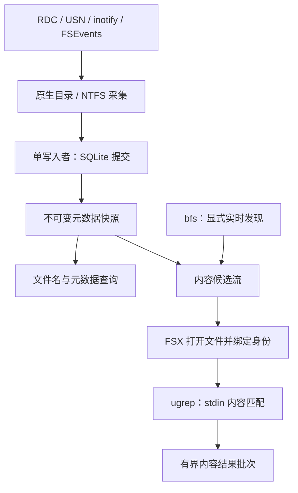

# 跨平台采集、变更监听与文件内容搜索

状态：Linux inotify 及首个 Linux 内容任务已进入实现，其余新增平台/内容能力仍为方案。2026-11-04。基于 FSX 合并提交
`0ac984784e69825011bafba97bed9bcf44e703d2`；已实现行为以
[运行时契约](runtime-contract.md)为准。本文细化
[主设计](FileSearch-C11-设计.md)的跨平台与内容搜索里程碑。

首个内容运行时的实际契约见[运行时文档](runtime-contract.md#linux-content-jobs)：
候选可显式选择保留结果窗口，或提交查询表达式流式扫描固定快照中的完整范围，
后者不受 UI 窗口限制、不预分配全量候选、不在背压期间持有 SQLite 读事务。
一个 engine 同时执行一个任务/ugrep 进程，一个未释放文件批次形成背压。
双进程并行和 BFS_LIVE 仍是后续目标；Windows/macOS 内容进程适配尚未实现。

## 1. 选定方案与范围

继续使用 FSX 原生采集器建立文件名/元数据索引，在 Linux 增加 inotify，
在 macOS 增加 FSEvents。SQLite 文件数据库保存已提交事实，现有不可变 C
快照服务名字查询。无需为 ext4、XFS、Btrfs、APFS 分别编写磁盘格式解析器。
文件系统格式与操作系统能力分别列入验收，不能因为 POSIX 扫描通过便声称所有卷受支持。

内容采用独立、显式的异步搜索能力：

- 已索引范围：固定元数据快照筛选候选，FSX 打开文件，ugrep 匹配读取到的内容。
- 未索引目录：显式选择 bfs 发现路径，FSX 核对并打开文件，ugrep 匹配内容。
- bfs 只用于 POSIX 实时内容搜索的候选发现与正式遍历基准；其 stdout 不直接写入事实表。
- ugrep 作为独立可执行工具复用，不把 C++ 源码链接进 C11 引擎。
- 首版搜索普通文本，不建立正文 FTS、不使用 ugrep-indexer，不自动调用文档转换器。

工具缺失、平台不支持、选定模式无法执行时直接报告错误；不自动更换后端、扫描模式、
匹配器或依赖版本。FSX 保持静态库；工具也按静态第三方依赖的目标单独验收，
不引入动态 provider 或运行时库探测。

## 2. 平台能力

| 平台/范围 | 当前实现 | 本方案增加 | 持久变更位置 |
| --- | --- | --- | --- |
| Windows 本地 NTFS | 原生目录扫描、MFT/USN、RDC；异步索引 | ugrep 内容搜索，先完成 LLVM-MinGW 工具资格 | 保留现有 USN 同事务检查点 |
| Windows 其他可枚举卷 | 通用目录采集、RDC 路径；未逐格式验收 | 同一内容 API，按实际卷验收 | RDC 无持久游标 |
| Linux 本地普通文件系统 | POSIX 扫描、异步索引/查询、持久化；本分支增加 inotify | ugrep；可选 bfs 实时发现 | inotify 无持久游标，重开需扫描 |
| macOS APFS 等可枚举卷 | 尚无正式构建/测试资格 | 扫描移植、Clang presets/CI、FSEvents、ugrep/bfs | 首版重开扫描；FSEvents 历史续读后续独立验收 |
| SMB/NFS、FUSE、伪文件系统、可移动卷 | 无通用监听完整性保证 | 仅公布逐项通过的能力；手动扫描为显式操作 | 不推断等同本地 NTFS |

Linux inotify 不递归，必须为目录树逐级注册；网络远端变化、mmap 修改及挂载覆盖有
通知边界。FSEvents 会合并事件，丢事件要求重新扫描。二者都不能把通知直接当成
完整文件事实。首版 `caught_up` 仅表示当前已确认的扫描/通知义务完成，
不承诺整个文件系统具有事务快照，也不承诺捕捉所有内容写入方式。[S1][S2]

## 3. 数据流与模块所有权



| 所有者 | 职责 |
| --- | --- |
| `source/directory.c` 及平台采集代码 | 原生名字、身份、别名、覆盖范围、句柄相对遍历 |
| `source/watch/` 拟拆分的 common/windows/linux/macos 源文件 | 平台通知、dirty generation、根身份和重新核对义务；源列表归 `src/CMakeLists.txt` |
| 现有 `index.c`、`storage/`、`model/` | 单写入者、事实/FTS/检查点事务、快照发布；内容搜索不进入写入者队列 |
| 拟新增 `content/` | 候选迭代、文件读取、ugrep 参数/协议、结果批次、内容预算 |
| 拟新增 `platform/process_*` | 明确 argv、句柄继承、并发排空管道、终止/回收子进程 |
| C API/CLI | 显式选择能力，展示实时内容语义、覆盖范围、限制及完成状态 |

复用 Core 的线程、条件变量和有界任务设施；CMeta 声明新配置/状态，
不承担进程或文件所有权。内容任务使用独立有界执行队列，避免慢文件和工具启动
占满名字查询池或单写入者。首版每个 engine 至多接收一个活动内容任务，
每任务至多两个 ugrep 子进程；后续并行度由实测决定。

## 4. 跨平台扫描与监听

### 4.1 通用采集契约

沿用来源、目录项与对象分离：POSIX 当前以 `st_dev` / `st_ino` 绑定对象，
路径只表示别名。设备号和 inode 可能复用，跨重启需重新确认根与条目，
不能把它们当成永久 UUID。硬链接按目录项返回；不因共享内容而删除别名。

目录采集默认记录 symlink 本身而不穿越。保持句柄相对打开与身份核对，
不将 Unicode 折叠键拿去重新打开文件。非法 UTF-8 名字继续明确计入 partial，
不能经替换字符生成假路径。macOS 保留原始名字，不将 APFS 的大小写或规范化
行为硬编码为所有卷通用规则；搜索仍遵循 FSX 公布的 Unicode 语义。

macOS 首先处理 `st_mtim` / `st_mtimespec` 时间字段适配、所需 POSIX 功能声明、
Core/CMeta SDK 架构和工具路径。通过正式 macOS 编译/测试后才宣布支持。
挂载边界必须显式配置并进入源配置指纹；bfs 发现首版固定不跨设备，
不悄悄改变现有元数据扫描的遍历策略。

### 4.2 Linux inotify

沿用现有协作式 `fsx_watch_open/wait/scan/close` 生命周期，首版不增加隐藏常驻线程。
调用者在 owner 线程驱动 wait/scan；异步普通索引 API 继续独立使用。
若后续提供异步 watch scan，再单独定义 owner 迁移与通知排空协议。

1. 打开并确认根，建立 nonblocking/CLOEXEC inotify 实例及停止唤醒描述符，
   在第一次枚举前注册根目录。
2. `fsx_watch_scan` 走原生扫描钩子：每个子目录在读取其内容前注册并核对身份。
   发现新建或移入目录时，先加 watch，再枚举已存在的后代；扫描期间定期排空事件。
3. 普通事件合并为根级 dirty generation。首版保持与 RDC 一致的整根核对，
   不按 rename cookie 猜测数据库 insert/delete。
4. 扫描记住起始 dirty generation，提交并发布后排空事件；只有本次覆盖了义务、
   且未出现新 dirty generation 时才可清 dirty。忙碌目录持续保持 dirty，
   不以固定重试次数宣称同步完成。
5. `IN_Q_OVERFLOW` 使监听覆盖失效。明确的 reconcile 操作重新建立 watch 集和全扫描，
   成功前保持 dirty；它是已选监听协议的恢复步骤，不切换到轮询后端。
6. `IN_UNMOUNT`、根替换或无法满足 watch 数量/权限要求时返回具体失败/局部覆盖。
   不修改系统 inotify 限额，不自动启用轮询，也不推进任何虚构游标。

watch map、路径存储、描述符数都计入预算；watch descriptor 映射绑定实例与对象，
实例重建时整批失效。数据库/WAL/SHM 位于监听根内的自触发问题沿用现有禁止策略。
订阅创建、删除、移动、属性和写入变化，不订阅 `IN_OPEN` / `IN_ACCESS`，
避免普通内容读取本身让索引持续 dirty。
目录以外硬链接写入、mmap、远端变化和挂载覆盖不由目录事件完整覆盖；
UI 与状态必须保留这个能力限制。[S1]

### 4.3 macOS FSEvents

首版同样由 owner 线程驱动专用 CFRunLoop，在 wait 内按 deadline 运行，
停止时唤醒；回调只合并状态，不执行 SQLite 或内容搜索。
启动 stream 后才开始扫描，扫描中按有界间隔泵送该 run loop。
启用根变化通知；普通与合并事件首版都只令根 dirty。

`MustScanSubDirs`、`UserDropped`、`KernelDropped`、`EventIdsWrapped` 保留整根核对义务。
`RootChanged`、卸载或根身份不符报告 stale，不默默跟随新路径。
停止、invalidate 和释放 stream 在 owner 线程完成后再释放回调上下文。[S2]

FSEvents 有历史事件能力，但首版不持久化一个看似等价于 USN 的 event ID。
后续续读必须同时定义设备标识、根身份、历史有效性、扫描交接，以及
事实/FTS/检查点同事务规则；通过独立验收后再启用。

## 5. 内容候选与一致性

### 5.1 两个显式入口

`INDEX_SNAPSHOT` 从已有查询计划选择候选，先按根、文件名、扩展名、大小和时间等
索引条件缩小范围。当前完整范围入口复用查询编译器，在保留快照上按条目顺序
逐项评估，匹配后进入文件管线；不排序，不受 UI 的结果窗口截断，不分配全量路径。
请求记录元数据 revision 和源覆盖范围；元数据评估的取消/截止时间与内容任务一致。
索引较旧时可漏掉新文件，结果必须携带该覆盖状态。

`BFS_LIVE` 不要求先写索引，候选来自 bfs 的 NUL 路径流；仅在 Linux/macOS
显式启用。固定语义相当于以下 argv（示例为可读展示，执行时不经过 shell）：

```text
bfs -P -f ABSOLUTE_ROOT -xdev -type f -print0
```

包括隐藏普通文件；不使用 `.gitignore`，不跟随符号链接、不跨设备。
FSX 按 NUL 增量切分，保留原路径字节并对当前 UTF-8 API 做覆盖统计。
工具非零退出、遍历权限错误或未闭合的路径帧均使发现范围不完整。
发现到的路径只是候选，不能直接提供对象身份；FSX 从已打开的根逐段打开核对。[S4]

选择 `INDEX_SNAPSHOT` 时不自动为缺失条目再跑 bfs；选择 `BFS_LIVE` 时不因 bfs
失败改用 native 遍历。未来若增加 Windows 实时发现，应为独立、显式能力。

### 5.2 文件读取与结果归属

首版选择 **FSX 打开文件，再以 stdin 交给 ugrep**。每个文件一次工具进程，
并行数固定有界。直接批量传路径虽然减少启动次数，却无法让 FSX 确认 ugrep
实际打开的对象，也会重新引入 symlink/替换竞争；首版不采用该路径。

1. 使用平台原生句柄相对路径打开普通文件，按已选遍历规则核对身份。
   索引候选身份不符则记录 changed 并跳过，不把另一个对象的内容挂到旧 entry key。
   FIFO、socket、设备、目录、symlink 和 Windows reparse/cloud placeholder 内容不读取。
2. 取得打开句柄的对象身份、大小、mtime/可用 change-time，记录读取起止单调时间。
   以有界缓冲读取并喂给子进程 stdin；不把整文件复制到 SQLite 内存库。
3. stdout/stderr 与 stdin 同时推进，避免长输出把写 stdin 阻塞住。
   本文件匹配先暂存于有界内存，进程正常完成后再核对打开句柄的元数据与路径关联。
4. 观察到修改、替换或读取错误时丢弃该文件未发布批次，计入 changed/error；
   首版不自动重试。没有观察到变化也只表明检查通过，不证明字节具有事务版本。
5. 成功文件作为不可变批次发布；保存原始候选路径、已验证对象身份、可选 entry key、
   元数据 revision、读取时间窗与 `content_semantics=LIVE_READ`。

打开句柄固定对象，并不阻止同一对象被并发写入；mtime/size 前后相等也不能证明
内容未变。文件替换、删除后 inode 复用与时间戳被恢复均不能靠两个 stat 排除。
因此结果不称为“revision N 的正文”，不声称全局或单文件原子内容快照。
后续如需严格正文版本，必须引入明确的快照或复制/哈希协议并单独定义代价。

内容首版以路径为候选单元，不按 inode 跨时间复用命中。硬链接别名可能在不同读取
时间得到不同结果，不做跨查询匹配缓存，也不依赖通知宣称内容缓存永远新鲜。
保留结果只保留匹配文字和观测信息；再次打开预览时是一次新的读取。

### 5.3 流式结果、总数与布尔语义

首版单独提供 content API/CLI，不向现有名字 AST 插入一个含义模糊的 `content:`。
元数据过滤为候选层，正文匹配为第二层，支持 literal 或显式 PCRE2 两种内容模式。
二者是不同、已公布的 ugrep 语义，不沿用名字搜索的 Unicode 17 full-fold 承诺。
首版区分大小写；PCRE2 按固定 ugrep 版本允许跨行表达式，不隐式扩展 fuzzy、
文档或 archive 能力。pattern 参数中的实际换行不接受，避免变成多个 pattern；
正则中的 `\n`、`\R` 等仍按该工具的正则语义执行。

结果单元为工具的“匹配记录”：已验证的 `%b` 格式按每次匹配输出，同一行可重复，跨行表达式则保留工具
返回的文字范围，不把记录数当成实际命中次数或唯一行数。行号从 1 开始，
byte offset 从 0 开始，分别表示记录首个匹配的起始行与偏移；字节偏移相对于
工具实际搜索的 UTF-8 流，首版不提供误导性的字符列号。
首版仅接收通过有界增量校验的 UTF-8 文本，拒绝 NUL；带 UTF-8 BOM 的文件在 FSX
读取层去除 BOM，并明确 offset 相对去 BOM 后的流。UTF-16/32、其他编码和二进制
单独计入 skipped，后续显式扩展。由 FSX 判别策略，不仅靠工具无命中来猜二进制。

只公布已发布批次的 `matched_files`、`match_records` 与 `files_scanned`。
扫描完成前总数未知；达到结果/字节限制、取消、超时、权限或 changed 跳过后
`complete=false`，不能把截断计数称为精确总数。`complete=true` 也仅覆盖已声明的
候选集合及文本策略，不表示整个当前文件系统都被搜索。

并行任务的到达顺序不保证稳定；首版 CLI 明示流式输出，不复用名字查询的
全局排序/分页承诺。每文件批次保持工具返回顺序。UI 消费后释放批次，对慢消费者
施加背压；达到任务 deadline 时停止，并保留已经确认的结果及不完整原因。

## 6. ugrep 协议与进程生命周期

### 6.1 固定协议

使用 vcpkg-cache 的真实 `ugrep`，不调用 `ug`、`ugrep+`、shell alias，
不传 `--config`、filter、递归或 archive 参数。显式固定工作目录、字符环境、
颜色、线程数和输出格式，不继承交互配置造成语义变化。[S3]

原型参数如下；真实参数由数组构造，pattern 是独立 argv 值：

```text
ugrep -J1 -F --color=never --line-buffered --label=fsx-input \
  --format={"line":%n,"offset":%b,"text":%J}%~ -e PATTERN -- -
```

`PCRE2` 模式将 `-F` 替换为 `-P`，不混用两种匹配器。pattern 必须为单行 UTF-8，
不能把换行展开成未声明的多个 pattern。`%J` 负责 JSON 字符串转义（包括跨行文字），
`%~` 分帧。
该格式仅携带内容，文件名由父进程附加，因此不需要解析带冒号或换行的路径输出。
不用 `--null-data` 传文件列表：它改变正文行分隔符；`--null` 是输出路径分隔选项，
不是向 stdin 提交路径队列的协议。bfs 的 NUL 路径流与 ugrep 的正文 stdin 分开。[S3]

JSON 解码器增量处理单行帧，固定字段/整数范围/转义规则；协议错误使本次工具执行失败。
超长帧或输出超限直接终止该文件并标记限制，不把截断 JSON 当成命中。
在实现正式端到端测试确认固定版本的参数组合前，这个 argv 只是协议设计，
不是已运行验证的命令。禁止在 CMake/CI 中通过临时探测选择另一格式或匹配器。

ugrep 退出码 `0` 表示有选中行，`1` 表示无选中行，`>1` 表示错误；
stdout 内容与退出状态共同核对。避免 `-q`，它在存在匹配时可能掩盖错误。
FSX 主动停止导致的 broken pipe/终止按本任务 cancel/limit/deadline 归类，
不误报为完整的“没有命中”。stderr 有界保存为诊断，继续排空或终止，避免死锁。[S3]

### 6.2 资源和取消

以下为首版设计默认值，不是性能结论；实现时纳入配置工厂和精确版本检查：

| 限制 | 初始值/动作 |
| --- | --- |
| 每 engine 活动内容任务 | 1；额外任务返回 busy，不无限排队 |
| 每任务 ugrep 进程 | 2；每个 `-J1`，另至多一个 bfs |
| 候选队列 | 128 项，同时受 1 MiB 路径字节预算约束 |
| 单文件读取上限 | 32 MiB，增长超过限制则该文件不完整 |
| 单个读缓冲 | 64 KiB |
| pattern / 输出帧 | 4 KiB / 64 KiB |
| 未消费结果及本文件暂存 | 合计 8 MiB，背压或明确终止；不可无限 spool |
| 每任务匹配记录上限 | 10,000，达到限制报告 truncated |
| 每进程 stderr 留存 | 64 KiB |
| 任务 deadline | 调用者指定，CLI 默认 30 s |

为避免本文件尚未发布时背压无法解除：已发布未消费批次占满预算时暂停分配下一个
文件；当前文件自己的暂存达到预算或记录上限时，停止该文件并报告 truncated。
首版只保留此前完整确认的文件批次，丢弃当前未完成文件的暂存记录；这意味着
一个超密集命中的文件可能只出现在“结果超限”的诊断中，不返回不完整文件批次。
取消、超长帧和工具错误也不发布当前文件暂存。若要返回文件内部的部分结果，
需后续另行定义可验证的批次边界，不能在首版偷换完成语义。

这些上限限制 FSX 内存、输入/输出和进程数量，不等于子进程 RSS 的可移植硬上限。
单独测量并报告 child peak memory；若调用者要求硬子进程内存上限，必须由该平台
已验收的进程限制能力提供，否则显式 unsupported，不谎称引擎 heap 预算已覆盖它。

POSIX 使用不经过 shell 的 spawn/exec、独立进程组和显式 fd action；Windows
使用显式程序绝对路径、正确 UTF-16 argv 编码、受限句柄继承及 Job Object。
取消/超时先停止提交与喂入，终止进程组/job，排空并回收进程，最后释放文件和批次。
引擎 STOPPING 同时取消内容任务；子进程未回收时 close 仍可超时并重试，
不能释放仍被异步 I/O 引用的上下文。取消不是每个文件自动重启工具。
普通文件的内核读取也可能阻塞；首版 deadline 是停止义务，不承诺能在任意文件系统
上强制中断一次读取或提供硬实时返回界限。进程/读取 worker 未退出时保留上下文并
返回可重试的关闭超时；正式基准分别记录正常本地卷取消时延与该平台的取消能力。

## 7. API 与 CLI 草案

新增独立 `FsContentRequest` / `FsContentQuery` / `FsContentInfo` /
`FsContentBatch`，沿用 `struct_size`、`api_version` 和配置工厂约定。
名字查询 API 不变。拟定入口：

```c
FsStatus fsx_content_submit(FsEngine *, const FsContentRequest *, FsContentQuery **);
FsStatus fsx_content_poll(FsContentQuery *, FsContentInfo *);
FsStatus fsx_content_wait(FsContentQuery *, uint64_t deadline_ns);
FsStatus fsx_content_batch_acquire(FsContentQuery *, FsContentBatch **);
void fsx_content_batch_release(FsContentBatch *);
void fsx_content_cancel(FsContentQuery *);
void fsx_content_release(FsContentQuery *);
```

请求包含候选来源枚举、索引条件或根、literal/PCRE2 模式、pattern、deadline 和限制；
不接受任意工具 argv、shell command 或隐式后端列表。
submit 复制请求字符串并保留所选元数据快照，deadline 使用与现有 API 一致的单调时钟。
`batch_acquire` 取出一个不可变批次并转交引用所有权；暂时无结果与任务结束由明确状态
区分。info 分离终止原因、coverage 与计数，包括候选未完成、changed、denied、
skipped encoding/binary、oversize、protocol/tool error、cancelled、truncated。
`content_wait` 在有批次可取或任务终止时唤醒，调用者循环 acquire/release 后继续 wait；
不能要求先等整个任务结束才取结果，否则会与有界结果背压形成死锁。

engine 打开时复制显式 `UGREP_ROOT` / `BFS_ROOT` 对应的运行时工具配置，
记录版本/包来源；不从 PATH 搜索或在线下载。未启用内容能力时不启动工具。
释放 query 停止其未完成工作，已 acquire 的批次保留到调用者 release，
计入 engine 的保留对象/close 规则。新类型通过正式 API/CLI 用例验证所有权。

拟定 CLI（尚不存在）：

```text
fsx content --db index.db --scope-query 'ext:c' --literal 'sqlite3_open'
fsx content --root /work/src --discover bfs --regex 'TODO|FIXME'
```

输出包含逐行命中及最终完整性/终止摘要；无命中且完整才使用成功无匹配退出语义。
文档转换、压缩包、非 UTF-8 和硬链接合并均需未来显式选项，不偷渡进这两个入口。

## 8. vcpkg-cache、静态依赖与平台资格

2026-11-04 检查共享仓库 `f1caf997152e4830d7e1089fceaf77aa9127ec25`
的端口内容如下；这些是配方事实，不表示每个平台已有可下载的二进制包：[S5]

| 工具 | 端口 | 当前配方边界 | 接入要求 |
| --- | --- | --- | --- |
| ugrep | 7.8.5#1 | Linux/macOS；Windows 仅 native MSVC x86/x64，排除 MinGW；显式 PCRE2，未带可选压缩依赖 | 增加并正式验证 LLVM-MinGW 原生工具构建、静态第三方依赖闭包 |
| bfs | 4.1.5#1 | native Linux/macOS；禁用可选 ACL/capability/SELinux/io_uring/Oniguruma | 保持精简配方，验证静态第三方依赖及 macOS 工具 |

当前 FSX 已有 `FSX_BUILD_SEARCH_TOOLS` / `search-tools` 可选 feature，但没有调用
工具的运行时内容 API；当前 ugrep POSIX 配方传 `--disable-static`，Windows 适配器
又明确要求 MSVC，因此不能把“已有端口”写成“静态 LLVM-MinGW 工具已经可用”。
本方案要求先在 vcpkg-cache 修订并验收端口，再通过已发布版本的显式 pin 接入。
静态目标指 FSX 和第三方链接闭包；Windows/macOS 必需系统库保留平台规定的链接形式，
Linux 是否选择全静态系统运行时须另定 triplet，不能由“static”一词推断。

FSX 当前基础设施 pin 仍为 `v0.1.002`；本设计提交不改 baseline、Action、triplet
或共享仓库。实现 PR 统一固定已发布的 cache source/Action 版本及完整 registry
baseline，记录真实工具包版本/哈希。普通产品构建按 manifest 获取依赖；
没有命中的 cache 可以按既定产品源码构建流程构建同一配方，不能自动换工具或降级功能。

运行时 bfs/ugrep 必须匹配**目标运行系统**，不是 Lemon/re2c 那类构建时 host generator。
首版仅允许 native 构建，使用已选 native prefix 下明确的 `tools/ugrep/ugrep[.exe]`
和 `tools/bfs/bfs`；不能为绕过平台限制简单加 `host: true`，把 host 程序打包给不同目标。
将来交叉编译需要分开声明 build-host 与 runtime-target 工具包。

构建继续使用版本化 presets、根选项和模块源列表；静态工具依赖在端口所有者处定义。
不增加项目 install/export/consumer 路径、配置自测、探测式 CI 或静默动态链接替代。
正式内容测试使用实际固定工具，缺工具的已启用 profile 直接失败，不能 skip 成功。

## 9. SQLite 内存与未来正文索引

本方案不需要 `NTFS -> SQLite(memory) -> SQLite(file)` 双份数据库。
保持现有有界采集缓冲、SQLite 内存工作表、文件数据库原子提交、不可变 C 快照发布。
内容候选从 C 快照流出，结果驻留在有界批次；无须将正文塞进 metadata writer。

ugrep-indexer 会引入另一套索引格式/失效协议，首版不启用。
若重复正文查询的测量证明需要索引，再单独设计 `content_objects` + 正文 FTS：
提取器版本、编码、读取版本/哈希、dirty 义务、删除/权限变化、空间预算和提交边界
均须确定；名字 FTS 与正文 FTS 分表。正文词项索引也不能自动加速所有 PCRE2 正则。

PDF/Office 需要明确的文本提取器及沙箱/资源协议。ugrep 的 filter 功能可运行外部
转换命令，不代表当前包内自带这些解析器；vcpkg-cache 当前还不打包 `ugrep+` 包装器。
首版不开放任意 filter command，也不以扫描二进制原始字节声称支持文档正文。[S3][S5]

## 10. 实施顺序与验收

| 阶段 | 改动 | 交付判据 |
| --- | --- | --- |
| A：平台基础 | macOS 扫描移植；明确本地卷能力；版本化 Clang presets/CI 与匹配 SDK | Linux/macOS 正式源内扫描/查询用例，symlink/别名/权限/Unicode/时间一致性 |
| B：监听 | watch 公共状态层；Linux inotify、macOS FSEvents；先整根核对 | 扫描前布防、新目录移入、rename、overflow/dropped、根替换、取消/关闭；旧结果仍有效 |
| C：工具资格 | vcpkg-cache ugrep LLVM-MinGW 与静态闭包；bfs Linux/macOS；发布固定版本 | 真实工具构建/运行和依赖检查，版本/哈希可追溯；无 install/consumer 项目 |
| D：按需内容 | 独立进程适配、INDEX_SNAPSHOT 候选、stdin ugrep、流式批次 | 真实 ugrep 端到端用例和并发/取消/失败传播；名字查询/索引无语义回归 |
| E：实时目录 | BFS_LIVE 路径流、原生打开核对、覆盖统计 | 真实 bfs；换行/前导横线/超长/非法 UTF-8 名字、权限、根移动与进程失败 |
| F：性能验收 | 扫描/监听/内容独立基准；是否需要后续批处理/正文索引的决定 | 同机同工具版本与一致语义的原始数据，未测能力不升级为支持声明 |

A/B 与 C 的代码工作可独立进行；D 先在已通过工具资格的平台启用，
Windows 要完成 C 的 LLVM-MinGW 要求后才启用。每个实现 PR 都保持可用、可验收，
不靠另一个尚未实现的后端补位。

正式测试放在项目 `tests/`，覆盖以下可观察行为：

- 监听模型测试及真实目录变更：扫描交接期间持续创建/移动，预算耗尽、溢出、
  不可读目录与根失效不产生虚假 clean；Linux 重开没有续读承诺。
- 内容：literal 与 PCRE2 明确区分；空文件、UTF-8/BOM、NUL、非法编码、CRLF、
  超长行、二进制、超大文件、无命中、错误退出、损坏输出、管道背压。
- 对象：读取中 rename/unlink/替换、同对象并发写入、硬链接；不向旧 entry key
  发布另一对象的内容，稳定 stat 不被宣称为强内容版本。
- 生命周期：同时建索引/名字查询/内容搜索、取消/超时、STOPPING、保留批次、
  子进程退出与回收；无遗留进程/句柄，截止时间与资源限制可观测。
- Linux ASan/UBSan 与所有平台正式原生用例；工具错误和 native 通知注入仅归测试设施，
  生产实现不包含替代 provider 或后端猜测。

基准固定语料、工具/SDK/提交、文件系统、文件数/字节量、命中密度与限制。
分别测十万小文本、少量大文本、UTF-8、无命中/密集命中、冷/热缓存；记录
候选阶段、进程启动、首次已确认结果、总耗时、files/s、MiB/s、父/子峰值内存、
CPU、取消时延及并行内容负载下名字查询 P50/P95/P99。
文件名索引写入仍记录事务/快照耗时，不能把 bfs 或内容吞吐当成 NTFS 索引速度。

特别记录“一文件一进程”的启动成本，用相同候选/匹配语义的直接 ugrep 调用作正式
基准对照，注明后者的路径重开语义。若小文件启动成本不可接受，再设计可复用的
有版本 worker 协议或明确不同语义的 batch 模式；不未经测量声称 bfs/ugrep 必然加速。

## 11. 依据

- [S1] [Linux inotify 手册](https://www.man7.org/linux/man-pages/man7/inotify.7.html)：
  非递归、新目录注册竞争、队列溢出、网络/mmap/挂载边界。
- [S2] [Apple FSEvents 指南](https://developer.apple.com/library/archive/documentation/Darwin/Conceptual/FSEvents_ProgGuide/UsingtheFSEventsFramework/UsingtheFSEventsFramework.html)：
  扫描前监听、事件合并/丢失、根变化、run loop 与历史事件。
- [S3] [ugrep 7.8.5 手册](https://github.com/Genivia/ugrep/blob/v7.8.5/man/ugrep.1)：
  stdin、`-J1`、`-F`/`-P`、format、JSON 转义、编码、退出状态和 filter。
- [S4] [bfs 4.1.5 手册](https://github.com/tavianator/bfs/blob/4.1.5/docs/bfs.1)：
  `-P`、`-f`、`-xdev`、`-type` 与 `-print0`。
- [S5] 共享端口检查点：
  [ugrep manifest](https://github.com/qigao/vcpkg-cache/blob/f1caf997152e4830d7e1089fceaf77aa9127ec25/ports/ugrep/vcpkg.json)、
  [ugrep recipe](https://github.com/qigao/vcpkg-cache/blob/f1caf997152e4830d7e1089fceaf77aa9127ec25/ports/ugrep/portfile.cmake)、
  [Windows adapter](https://github.com/qigao/vcpkg-cache/blob/f1caf997152e4830d7e1089fceaf77aa9127ec25/ports/ugrep/CMakeLists.txt)、
  [bfs manifest](https://github.com/qigao/vcpkg-cache/blob/f1caf997152e4830d7e1089fceaf77aa9127ec25/ports/bfs/vcpkg.json)、
  [bfs recipe](https://github.com/qigao/vcpkg-cache/blob/f1caf997152e4830d7e1089fceaf77aa9127ec25/ports/bfs/portfile.cmake)。
